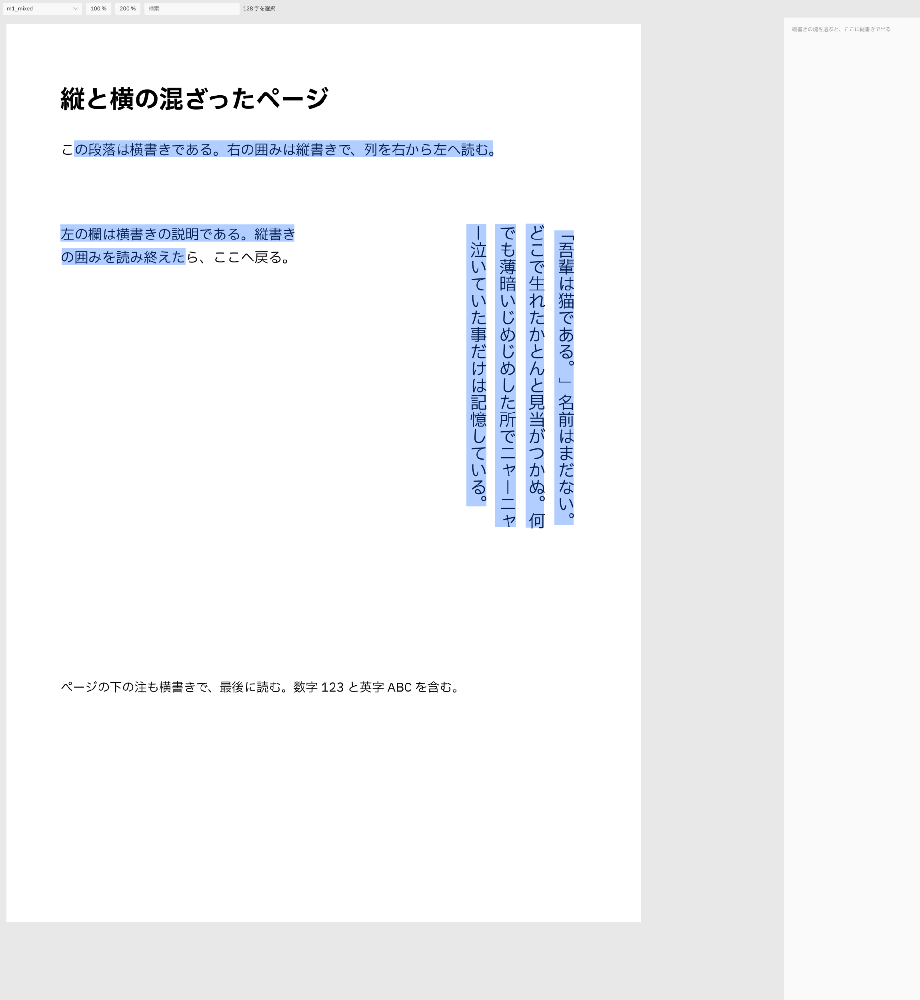
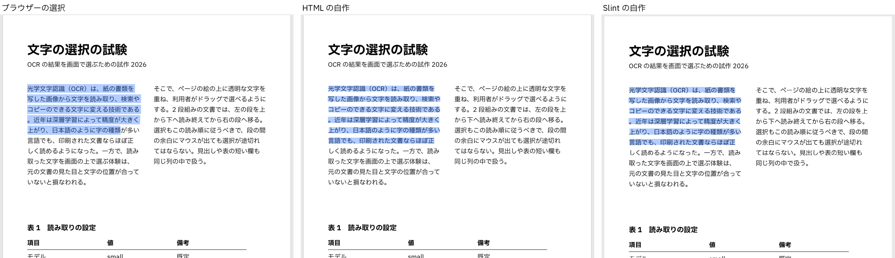

# OCR の文字の選択の試作の報告（HTML と Slint）

- ブランチ: `spike/ocr-select`（`origin/spike/slint-crop` から。マージしない）
- 確かめた環境: クラウドの Linux（画面なし、4 vCPU）。Node v22.23.4、Rust 1.99.0。

## 1. 骨組みと入力

### 入力のページ

`spike/ocr-vertical`（6a75db4）を別の作業木でビルドし、`ocr-spike/scripts/fetch.sh` でモデル（PP-OCRv6 small／medium）を、作業木の中の `node scripts/fetch-layout.ts` で onnxruntime 1.26.0 を取った。フォントは `@ibm/plex-sans-jp` の woff を fontTools で OTF に戻し、`scripts/vert_map.py` で `plex_vert.json` を作った（どれも作業木の `data/` の中だけ。git に入れない）。

| ページ | 作り方 | `page-json` の引数 | 塊 |
| --- | --- | --- | --- |
| `h1_two_columns`（横書き） | [fixtures/gen_pages.py](fixtures/gen_pages.py)（Pillow、IBM Plex Sans JP）。見出し、2 段組みの本文、4 行 3 列の表、最後の 1 行 | なし | 10 |
| `v2_two_tiers`（縦書き） | `ocr-spike` の `vertical`（横書きの柱、縦書きの 2 段、ノンブル） | `--vcut --vcut-guard 1,3,0.1` | 5 |
| `v4_dialogue`（縦書き） | 同上（かぎ括弧の会話の入った 1 塊） | 同上 | 2 |
| `m1_mixed`（混ざったもの） | `gen_pages.py`（縦書きは Pillow の raqm の `direction="ttb"` と `vert`） | 同上 | 6 |

- 画像は A4 を 200 dpi（1654 × 2339 px）。`page-json` は A4 の 595 × 842 pt として座標を出す。
- **2 段組みの読み順**: `ocr-spike` の読み順（`order.rs` の規則 4）は、横書きの塊が横に並んだ帯を「行ごとに帯をまたいで」読む（帳票のため）。そのため 2 段組みの本文が「左の 1 行、右の 1 行、…」と交互になった（[fixtures/h1_two_columns.raw.json](fixtures/h1_two_columns.raw.json)）。選択の試験では段の順に読むほうが意味があるので、[fixtures/regroup.py](fixtures/regroup.py) で本文の帯だけを左右の 2 塊に組み直した。**OCR の画面を作るときは、読み順の規則 4 を、段組み（同じ幅の行が縦に続く）と帳票で分ける必要がある**。
- OCR の読み違いもそのまま残した（`値` → `值`、縦書きの `ー` → `一`、2 段目の柱の位置に `6` など）。選択の正解は `OcrPage` の文字なので、読み違いは比べる妨げにならない。

### 骨組み

- [web/](web/): Vite 8.3.6 ＋ React 19.3.1 ＋ TypeScript 6.0.3（アプリの `package.json` と同じ系列）。`fixtures/` を Vite の `publicDir` にして、ページの絵と JSON を読む。100 % は 1 pt = 96/72 px（pdf.js と同じ）。
- [slint/](slint/): Slint 1.18.1、自分の `[workspace]`。同じ `fixtures/` を読む。フォントは前の試作と同じく Plex Sans JP の TTF（git に入れない）。

### 確かめの道具

- **Chromium**: 入れ物の Playwright 1.63.0 と Chromium（`/opt/pw-browsers`）。
- **WebKit**: Playwright の WebKit は取れなかった（`playwright install webkit` が `cdn.playwright.dev` と `playwright.download.prss.microsoft.com` への接続をネットワークの決まりで断られた）。代わりに `apt` で **WebKitGTK 2.52.6**（`libwebkit2gtk-4.1-0`、Tauri が Linux で使うものと同じ）と `webkit2gtk-driver`（`WebKitWebDriver`）を入れ、付属の `MiniBrowser` を Xvfb の上で WebDriver（W3C の Actions）から動かした。Playwright の WebKit より、**Linux の Tauri の WebView そのもの**に近い。
- **Slint**: Xvfb と `Window::dispatch_event`（前の試作の `drive.rs` を写す）。

## 2. HTML（ブラウザーの選択を使う）

### どう作ったか

- [web/src/native/NativeView.tsx](web/src/native/NativeView.tsx): pdf.js の text layer と同じく、OCR の **1 行を 1 つの透明な `span`** にして、行の箱の左上に `position: absolute` で置く。字の大きさは行の太さ（横書きは高さ、縦書きは幅）。描いたあと自然な幅（縦書きは高さ）を測り、`transform: scaleX`（縦書きは `writing-mode: vertical-rl` と `scaleY`）で行の長さに合わせる。行の後ろに ` `、塊の後ろにもう 1 つ ` ` を置く。
- 選択とコピーは `window.getSelection` とブラウザーのコピーにまかせた。**コピーの形（行の間は改行、塊の間は空行、縦書きは列の順）は、` ` の置き方だけで Chromium と WebKitGTK の両方で正解と一致した**（`all` の台本）。
- 帯はブラウザーの `::selection`（文字は透明、背景だけ色を付ける）。
- 縦書きの欄: 選択の focus のある塊が縦書きなら、横の欄に `writing-mode: vertical-rl` で行を `div` ごとに出す。欄の中の選択とコピーもブラウザーまかせ。
- 検索はブラウザーにないので、項目 3・4 と同じ自作の検索（[web/src/core/search.ts](web/src/core/search.ts)、字の列を NFKC と小文字にそろえ、塊の中の行はつないで探す）と、字の 4 点からの帯（[web/src/core/select.ts](web/src/core/select.ts) の `bands`）を使った。

### 工夫が要った所

1. **Ctrl+A**: ブラウザーの全選択は、道具の欄や横の欄まで選ぶ。`keydown` で Ctrl+A を取り、`Range.selectNodeContents` で text layer（欄にいるときは欄）だけを選ぶようにした（20 行）。道具の欄は `user-select: none`。
2. **すき間で選択が飛ぶ**: 工夫なしでは、塊の間・行の後ろ・余白にドラッグが出ると、**選択の端がページの最後（text layer の最後の要素）まで飛んだ**（Chromium と WebKitGTK の両方、下の表の 11 か所すべて）。pdf.js の工夫（`text_layer_builder.js` の `#enableGlobalSelectionListener`。押している間だけ text layer 全体を覆う空の `div` を後ろに敷き、選択が変わるたびにそれを DOM の中で選択の動く端の直後へ移す）を写した（[web/src/native/endOfContent.ts](web/src/native/endOfContent.ts)、42 行）。これで「最後まで飛ぶ」はなくなったが、**すき間では選択が「最後に字の上にあった位置」で止まる**（いちばん近い行の端へは伸びない）。行の右の余白へ素早く抜けると、行の途中で止まる。
3. **縦書きの字形（WebKitGTK）**: WebKitGTK 2.52.6 は、`writing-mode: vertical-rl` だけでは、フォントの縦書き用の字形（OpenType の `vert`）を使わなかった。句読点が横書きの位置に出て、かぎ括弧と長音が横向きのままになった（[screenshots/webkitgtk-vert-test.png](screenshots/webkitgtk-vert-test.png)。左から Plex Sans JP（webfont）、Noto Sans CJK JP（OS のフォント）、Plex に `font-feature-settings: "vert" 1`、`text-orientation: upright`、`lang="ja"`）。**明示して `font-feature-settings: "vert" 1` を付けると正しくなった**。Chromium は何も付けなくても正しい（[screenshots/chromium-vert-test.png](screenshots/chromium-vert-test.png)）。確かめのページは [fixtures/vtest.html](fixtures/vtest.html)。Linux の Tauri（WebKitGTK）で縦書きを出すなら、この 1 行が要る。
4. **フォント**: 入っていないフォント名（`"IBM Plex Sans JP"`）を、WebKitGTK は fontconfig の代わりのフォント（この入れ物では Inter）で受けてしまい、日本語は別のフォントに落ちた。アプリと同じく Plex Sans JP を webfont として同梱した（`@ibm/plex-sans-jp`、OFL-1.1、アプリと同じ依存）。webfont が読み込まれると字の幅が変わるので、`document.fonts.ready` のあとに `scaleX` を測り直す必要があった。
5. **欄のあふれ（WebKitGTK）**: `writing-mode: vertical-rl` の箱を横書きの欄に置くと、列があふれたとき WebKitGTK は右へはみ出し、最初の列が見えなくなった。欄そのものを `vertical-rl` にすると、あふれは左へ伸び、右から読み始められた（Chromium は両方で同じ見た目）。

### 結果（倍率 100 %、[results/](results/)）

台本は項目 5 のもの。○ は正解と同じ、△ は端が 1〜2 字ずれた、× は違う。正解は「字の 4 点からいちばん近い行の、字の境目」（項目 3 の決まり）なので、すき間で終わる台本（`end-*`）の × は「ブラウザーは別の所で止めた」の意味。

| 台本 | Chromium 工夫なし | Chromium pdf.js の工夫 | WebKitGTK 工夫なし | WebKitGTK pdf.js の工夫 |
| --- | --- | --- | --- | --- |
| Ctrl+A → Ctrl+C（4 ページ） | ○○○○ | ○○○○ | ○○○○ | ○○○○ |
| 塊をまたぐドラッグ（4） | ○○○○ | ○○○○ | ○○○○ | ○○○○ |
| 余白を通って字で終わる（4） | ○○○○ | ○○○○ | ○○○○ | ○○○○ |
| Shift+クリック（4） | ○○○△ | ○○○△ | ○○○○ | ○○○○ |
| 行の後ろのすき間で終わる（4） | ×××× | ×△×△ | ×××× | ×○×○ |
| 塊の間のすき間で終わる（4） | ×××× | △×△× | ×××× | ××△× |
| 余白で終わる（4） | ××○× | ×○×× | ××○× | ××○× |
| 行をまたぐ検索（4） | ○○○○ | ○○○○ | ○○○○ | ○○○○ |
| 縦書きの欄: Ctrl+A、ドラッグ（3 ページ × 2） | ○○○○○○ | ○○○○○○ | ○○○○○○ | ○○○○○○ |
| 合計 38 | 26 ○、1 △ | 26 ○、5 △ | 27 ○ | 29 ○、1 △ |

- 工夫なしの × はすべて「ページの最後まで飛ぶ」だった（コピーした字が 100〜300 字多い）。
- △ の多くは、**ブラウザーが置いた字の位置と OCR の字の位置の差**。1 行を 1 つの `span` にして `scaleX` で伸ばすので、ブラウザーの中では字が等間隔に並ぶ。OCR の字の 4 点は等間隔ではない（句読点や英数字は狭い）ので、行の途中では 1〜2 字ずれる。字ごとに `span` を置けばずれはなくなるはずだが、要素が 10 倍になり、pdf.js もそうしていない（試していない）。
- Chromium と WebKitGTK の差は、すき間で止まる位置の細部だけで、コピーの形と縦書きの選択は同じだった。

### 行数

| 部分 | ファイル | 行数 |
| --- | --- | --- |
| text layer、Ctrl+A、縦書きの欄 | [native/NativeView.tsx](web/src/native/NativeView.tsx) | 116 |
| すき間の工夫（pdf.js の写し） | [native/endOfContent.ts](web/src/native/endOfContent.ts) | 42 |
| 検索と帯（項目 4 と共用） | [core/search.ts](web/src/core/search.ts)、[core/select.ts](web/src/core/select.ts) の `bands`、[shared/](web/src/shared/) | 約 60 |
| 型と字の列（項目 4 と共用） | [core/ocr.ts](web/src/core/ocr.ts) | 115（うち型 50） |

（空行とコメントだけの行を除く。試験と台本 `web/tests/` を除く。）

- かかった時間: 約 1 時間半（うち WebKitGTK の字形・フォント・あふれの調べに約 40 分）。

## 3. Slint（字の 4 点から自作）

### どう作ったか

仮説どおり、**文字を描かず、フォントの寸法も調べず**、OCR の字の 4 点だけで作った。ページの上には絵と帯（`Rectangle`）と 1 枚の `TouchArea` しかない。

- **字の列**（[slint/src/model.rs](slint/src/model.rs) の `Flat`）: `OcrPage` の塊 → 行 → 語 → 字を読み順に 1 列に並べ、各字に「塊・行・語」の番号と箱を持たせる。選択は列の中の 2 つの位置（anchor と focus、字の間の位置）で持つ。
- **当たり判定**（`caret_at`、15 行）: 押した点から**いちばん近い行**（行の箱までの距離）を選び、その行の中で、文字の進む向き（横書きは x、縦書きは y）に字の中心と比べて、字の間の位置を決める。塊の間・行の後ろ・余白の点も必ずどこかの行に落ちるので、**選択が飛ばない**。縦書きと横書きの違いは「どちらの座標で比べるか」の 1 か所だけ。
- **帯**（`bands`、15 行）: 選んだ範囲を行ごとに切り、最初の字の 4 点の始まりの辺と最後の字の終わりの辺から箱を作る。縦書きの 4 点は右上から始まる順なので、同じ式で列に沿った帯になる。`.slint` では pt の箱に `scale` を掛けて `Rectangle` を並べるだけ（[slint/ui/app.slint](slint/ui/app.slint) の `Bands`）。拡大しても窓の大きさを変えても、帯はページの `Rectangle` の子なので位置がずれない。
- **コピー**（`text`、20 行と [slint/src/app.rs](slint/src/app.rs) の `copy`）: 範囲の字をつなぎ、塊が変われば空行、行が変われば改行、語が変われば空白。クリップボードは `arboard`（X11 では `Clipboard` を生かしておく間だけ選択を配るので、状態に持ち続ける）。
- **Ctrl+A・Ctrl+C**: `FocusScope` の `key-pressed`。ページか欄か、最後に押したほうに効く。
- **Shift+クリック**: `TouchArea` の `pointer-event` の `modifiers.shift` で、anchor を残して focus だけを動かす。
- **ドラッグ**: `TouchArea` は押してから離すまでポインターをつかみ続けるので、ページの外まで出ても `moved` が来る（自作は要らなかった）。
- **検索**（`search`、30 行）: 項目 2 と同じ決まり。`unicode-normalization` で NFKC。
- **縦書きの欄**（[slint/src/panel.rs](slint/src/panel.rs) 30 行、前の試作の [slint/src/vtext.rs](slint/src/vtext.rs) をそのまま写した）: `vtext::layout` が 1 字ずつ升を決める（句読点・括弧は縦書き用の字に、長音と英数字は 90° 回す、小さいかなと句読点は右上へ、行頭の禁則はぶら下げ）。升の位置は Rust が決めるので、**その升を欄の「字の 4 点」にして、ページと同じ `Flat` に入れた**。欄の中の当たり判定・帯・コピー・Ctrl+A は、ページのコードをそのまま使う（新しく書いたのは升から 4 点を作る 5 行）。

### 結果

- 項目 5 の台本 38 個が、倍率 100 % と 200 % の両方で全部正解（[results/slint-1.json](results/slint-1.json)、[results/slint-2.json](results/slint-2.json)）。Rust の側で作ったページ全体の文字が、TypeScript で作った正解と同じことも確かめた。
- 帯の絵: [screenshots/slint-h1-100.png](screenshots/slint-h1-100.png)（横書き 2 段、行の後ろのすき間で終えたドラッグ）、[screenshots/slint-m1-200.png](screenshots/slint-m1-200.png)（200 %、横書き → 縦書き → 横書きの塊をまたぐ）、[screenshots/slint-m1-panel.png](screenshots/slint-m1-panel.png)（縦書きの欄の中の選択）。

### 行数

| 部分 | ファイル | 行数 |
| --- | --- | --- |
| `OcrPage` の型と字の列、ページ全体の文字 | [model.rs](slint/src/model.rs) の前半 | 約 95 |
| 当たり判定と帯 | `caret_at`、`bands` | 30 |
| 範囲の文字 | `text` | 20 |
| 検索 | `search` | 30 |
| 窓とのつなぎ（押す・動かす・Ctrl+A・Ctrl+C・クリップボード・検索・欄の切り替え） | [app.rs](slint/src/app.rs) | 146 |
| 画面（道具の欄、ページ、帯、`TouchArea`、欄の字と帯） | [app.slint](slint/ui/app.slint) | 158 |
| 縦書きの欄の升 | [panel.rs](slint/src/panel.rs) ＋ [vtext.rs](slint/src/vtext.rs)（試験を除く 55） | 85 |
| 合計（`main.rs` 20 を含む） | | **約 585** |

（空行とコメントだけの行を除く。台本の [script.rs](slint/src/script.rs) 127 と [drive.rs](slint/src/drive.rs) 29 を除く。）

- かかった時間: 約 1 時間（ビルドの待ちを含む）。最初の実行で 38 個が通った（項目 2 より先に TypeScript で同じ決まりを書いていたので、移すだけだった）。

### 突き当たったこと

- 大きなものはなかった。小さなもの:
  - 自分の部品に `color` という名前のプロパティを足そうとすると「Cannot override property 'color'」で止まる（`Rectangle` の祖先の名前と重なる）。`fill` にした。
  - 1.18.1 では `ScrollView` の `viewport-width` は非推奨（`content-width`）。
  - 欄の大きさ（300 × 600 px）を Rust と `.slint` の両方に書いた。Rust が升を決めるので、`.slint` の欄の大きさを Rust に渡すか、定数を 1 か所にする仕組みが要る（製品では `changed width` で Rust に伝えて組み直す）。
  - Linux で winit を動かすには `libxkbcommon-x11` が要った（入れ物に入っていなかった。前の試作の入れ物にはあった）。
- **Slint がしてくれたこと**: ポインターのつかみ（ドラッグが外に出ても続く）、修飾キー、キーのフォーカス、拡大とスクロール、1 字ずつの `Text` の回転。**自作したこと**: 当たり判定、選択の範囲、帯、コピーの文字、クリップボード、検索、縦書きの升の配置。

## 4. HTML（字の 4 点から自作）

### どう作ったか

項目 3 と同じ作りを TypeScript で書いた。実は項目 3 より先に、この作りの中心（[web/src/core/ocr.ts](web/src/core/ocr.ts) の字の列と `textOf`、[web/src/core/select.ts](web/src/core/select.ts) の `caretAt`・`bands`、[web/src/core/search.ts](web/src/core/search.ts)）を書き、Rust はそれを写した。2 つはほぼ 1 対 1 で対応する（`caret_at` ↔ `caretAt` など）。

- [web/src/custom/CustomView.tsx](web/src/custom/CustomView.tsx): ページの上に透明な `div` を 1 枚かぶせ、`pointerdown`（`setPointerCapture` でつかむ）と `pointermove` で anchor と focus を動かす（[useSelection.ts](web/src/custom/useSelection.ts)、19 行）。帯は `div` を並べる（[shared/Bands.tsx](web/src/shared/Bands.tsx)）。ページの上には選べる文字の DOM がない。
- Ctrl+A は `keydown`、Ctrl+C は `copy` イベントで `clipboardData.setData` する。`copy` イベントは、DOM の選択がなくても Ctrl+C で Chromium と WebKitGTK の両方で来た（クリップボードの許可は要らない）。
- **縦書きの欄**（[custom/VerticalPanel.tsx](web/src/custom/VerticalPanel.tsx)、80 行）: 字の配置は**ブラウザーにまかせた**（`writing-mode: vertical-rl`、字ごとに `span`）。描いたあと各 `span` の `getBoundingClientRect` を測って欄の「字の 4 点」にし、ページと同じ `caretAt`・`bands`・`textOf` で選ぶ。Slint では `vtext.rs` が升を決めたところを、HTML ではブラウザーの組版を測って代える形。句読点の向き・ぶら下げ・英数字の回転はブラウザーとフォントがしてくれる（WebKitGTK では項目 2 の `vert` の 1 行が要る）。

### 結果

| | Chromium | WebKitGTK |
| --- | --- | --- |
| 台本 38 個（倍率 100 %） | **38 ○** | **37 ○、1 △** |

- △ は WebKitGTK の縦書きの欄でのドラッグ（`v4_dialogue` の `panel-drag`）で、終わりが 2 字手前になった。台本は欄の字の `span` の箱の下 14 px で離すが、WebKitGTK では折り返した列の境目の字の箱が Chromium と違う位置に出たためと見ている（詳しくは追っていない）。
- 項目 2 で × だったすき間の台本は全部 ○（正解の決まりと同じ作りなので当然ではある）。**Chromium と WebKitGTK の差は、欄の 1 か所を除いてなかった**（ページの上はブラウザーの組版を使わないので、差の出ようがない）。

### 行数

| 部分 | ファイル | 行数 |
| --- | --- | --- |
| 型と字の列、範囲の文字 | [core/ocr.ts](web/src/core/ocr.ts) | 115（うち型 50） |
| 当たり判定と帯 | [core/select.ts](web/src/core/select.ts) | 43 |
| 検索 | [core/search.ts](web/src/core/search.ts) | 23 |
| ページの重ね、キー、コピー | [custom/CustomView.tsx](web/src/custom/CustomView.tsx) ＋ [useSelection.ts](web/src/custom/useSelection.ts) | 97 |
| 縦書きの欄（ブラウザーの組版を測る） | [custom/VerticalPanel.tsx](web/src/custom/VerticalPanel.tsx) | 80 |
| 帯・ページの枠（項目 2 と共用） | [shared/](web/src/shared/) | 35 |
| 合計 | | **約 395**（`App.tsx` 51 と CSS 30 を除く） |

- かかった時間: 約 30 分（中心は項目 2 のときに書いてあった）。
- **項目 2 との差**: ブラウザーの選択を使う版（約 330 行、うち共用の型と検索を含む）と、ほぼ同じ行数だった。自作の版は、すき間で飛ばない・OCR の字の位置どおりに帯が出る・ブラウザーの差がない、の 3 点で出来が上。失うのは、ブラウザーの選択の作法（ダブルクリックで語、右クリックの「コピー」、選択したままのドラッグ＆ドロップ、スクリーンリーダーが文字を読めること）で、これらは項目 7 で見る。
- **項目 3 との差**: ページの選択のコード（字の列・当たり判定・帯・コピー・検索）は、TypeScript 約 180 行と Rust 約 175 行でほぼ同じ。差は、縦書きの欄（HTML はブラウザーの組版を測る 80 行、Slint は `vtext.rs` の自作の組版 85 行）と、つなぎの書き方（React の state と Slint のコールバック）だけだった。

## 5. 自動の確かめ

### 台本

- [web/tests/scenarios.js](web/tests/scenarios.js) が、ページの字の列から、ページごとに 8〜10 個の操作の台本を作る（[web/tests/gen-scenarios.mjs](web/tests/gen-scenarios.mjs) が [fixtures/scenarios/](fixtures/scenarios/) に JSON で書く）。座標はページの pt なので、3 つの作りが同じ JSON を流す。
  - `all`: クリック → Ctrl+A → Ctrl+C。正解は `OcrPage` の塊 → 行 → 語を読み順につないだ文字（行の間は改行、塊の間は空行、語の間は空白）。
  - `cross-blocks`: 2 つ目の塊の 2 字目から、最後から 2 つ目の塊の中ほどまで、まっすぐドラッグ（途中で塊の間のすき間を通る）。
  - `end-in-line-gap`・`end-between-blocks`・`end-in-margin`: 字から、行の後ろのすき間・塊と塊の間・ページの左の余白（x = 6 pt）へドラッグして離す。正解は「いちばん近い行の字の境目」の決まり。
  - `through-margin`: 字から塊の間 → 余白 → 字へと寄り道して、字で離す。
  - `shift-click`: クリック、Shift+クリック、Ctrl+C。
  - `search-across-lines`: 行の最後の 2 字と次の行の最初の 2 字を検索し、帯の数と位置（pt、1 pt 以内）を比べる。
  - `panel-all`・`panel-drag`（縦書きの塊のあるページ）: 縦書きの塊を押して欄に出し、欄の中で Ctrl+A、または 1 列目の 3 字目から 2 列目の終わりまでドラッグして Ctrl+C。
- 流すもの:
  - HTML: [web/tests/run-web.mjs](web/tests/run-web.mjs)。Chromium は Playwright（クリップボードは `navigator.clipboard.readText`）。WebKitGTK は `WebKitWebDriver` の W3C Actions（本物のポインターとキーのイベント）で、クリップボードは Xvfb の X11 のクリップボードを `xclip` で読む。
  - Slint: [slint/src/script.rs](slint/src/script.rs)。`Window::dispatch_event` で本物のポインターとキーのイベントを送り、`arboard` でクリップボードを読む。検索だけは、`LineEdit` に打つ代わりに `search` のコールバックを直接呼んだ。

### 結果（○ 正解、△ 端が 1〜2 字ずれ、× 違う。各 38 個）

| 作り | Chromium 100 % | Chromium 200 % | WebKitGTK 100 % | WebKitGTK 200 % |
| --- | --- | --- | --- | --- |
| HTML ブラウザーの選択、工夫なし | 26 ○ 1 △ 11 × | 26 ○ 1 △ 11 × | 27 ○ 11 × | （流していない） |
| HTML ブラウザーの選択、pdf.js の工夫 | 26 ○ 5 △ 7 × | 26 ○ 5 △ 7 × | 29 ○ 1 △ 8 × | 29 ○ 1 △ 8 × |
| HTML 自作 | **38 ○** | **38 ○** | 37 ○ 1 △ | **38 ○** |
| Slint 自作（Xvfb、ソフトウェアの描き方） | **38 ○**（100 %） | **38 ○**（200 %） | | |

- ブラウザーの選択の × と △ は、すべて**すき間で終わるドラッグ**と、**字の位置のずれ**（1 行を 1 つの `span` で伸ばすため）。Ctrl+A・塊をまたぐドラッグ・Shift+クリック・コピーの形・縦書きの欄は、両方のブラウザーで正しかった。
- 倍率 100 % と 200 % で結果は同じだった（どの作りも、座標を pt で持ち、倍率を掛けて置くだけなので）。
- 結果の JSON は [results/](results/)。

### 帯の位置の絵（左から ブラウザーの選択（Chromium、pdf.js の工夫）、HTML の自作（Chromium）、Slint の自作）

| | 100 % | 200 % |
| --- | --- | --- |
| 横書き 2 段、塊をまたぐ | [bands-h1_two_columns-cross-blocks-100.png](screenshots/bands-h1_two_columns-cross-blocks-100.png) | [200](screenshots/bands-h1_two_columns-cross-blocks-200.png) |
| 横書き 2 段、行の後ろのすき間で離す | [100](screenshots/bands-h1_two_columns-end-in-line-gap-100.png) | [200](screenshots/bands-h1_two_columns-end-in-line-gap-200.png) |
| 縦書き 2 段、塊をまたぐ | [100](screenshots/bands-v2_two_tiers-cross-blocks-100.png) | [200](screenshots/bands-v2_two_tiers-cross-blocks-200.png) |
| 縦書き、列の下のすき間で離す | [100](screenshots/bands-v4_dialogue-end-in-line-gap-100.png) | [200](screenshots/bands-v4_dialogue-end-in-line-gap-200.png) |
| 混ざったページ、塊をまたぐ | [100](screenshots/bands-m1_mixed-cross-blocks-100.png) | [200](screenshots/bands-m1_mixed-cross-blocks-200.png) |

- 上の絵で、ブラウザーの選択は 5 行目の「字の種類|が多い」で止まっている（ポインターは 6 行目の後ろのすき間）。自作の 2 つは 6 行目の終わりまで伸びている。
- 帯の形: ブラウザーの選択の帯は、`span` の行の箱（字の大きさ × 行の高さ）になり、行の間が詰まった塊では隣の行と重なりかける。自作の帯は OCR の字の 4 点の箱なので、絵の字にぴったり合う。どれも 100 % と 200 % でずれは見られなかった。
- WebKitGTK の縦書きの欄: [screenshots/webkitgtk-native-panel.png](screenshots/webkitgtk-native-panel.png)（ブラウザーの選択。`vert` を付けたあと、句読点と括弧が正しい）、[screenshots/webkitgtk-custom-panel.png](screenshots/webkitgtk-custom-panel.png)（自作）。

## 6. 比べる

行数は空行とコメントだけの行を除き、試験と台本を除く。時間はおおよそ。

| 機能 | HTML ブラウザーの選択（項目 2） | Slint 自作（項目 3） | HTML 自作（項目 4） |
| --- | --- | --- | --- |
| 型と字の列（共通の下ごしらえ） | 115（TS、型 50 を含む。検索の帯にだけ使う） | 約 95 | 115（項目 2 と共用） |
| 1. 重ね | text layer 約 45（行の `span`、`scaleX` の測り直し、webfont の待ち） | 帯の `Rectangle` と `TouchArea` 約 30（`.slint`） | 透明な `div` 1 枚 ＋ 帯 約 15 |
| 2. 選択（ドラッグ、すき間、Shift、Ctrl+A、帯） | ブラウザー ＋ pdf.js の工夫 42 ＋ Ctrl+A 20 | 当たり判定と帯 30 ＋ つなぎ 約 60 | 当たり判定と帯 43 ＋ ポインター 19 ＋ キー 約 15 |
| 3. コピー | ブラウザー（` ` の置き方だけ） | 範囲の文字 20 ＋ `arboard` 15 | 範囲の文字（共用）＋ `copy` イベント 約 10 |
| 4. 縦書きの選択 | ブラウザー（何も足さない） | 同じコード（4 点の順で吸収） | 同じコード |
| 5. 縦書きの表示と欄の選択 | `writing-mode` 約 15 ＋ WebKitGTK の `vert` 1 行 | `vtext.rs` 55（前の試作）＋ 升 → 4 点 30 ＋ `.slint` 約 40 | `writing-mode` で並べて測る 80 |
| 6. 検索 | 自作 23 ＋ 帯 約 20 | 自作 30 ＋ つなぎ 約 10 | 自作 23 ＋ 帯（共用） |
| 画面の枠（道具の欄、ページ、拡大） | 約 80（App、CSS、共用） | 約 60（`.slint`）＋ `main.rs` 20 | 項目 2 と共用 |
| **合計** | **約 330** | **約 585** | **約 395** |
| かかった時間 | 約 1 時間半（WebKitGTK の調べ 40 分を含む） | 約 1 時間 | 約 30 分（中心は項目 2 で書いた） |
| ブラウザー・Slint がしたこと | 選択、帯、コピー、縦書きの組版と選択、Shift+クリック、（試していないが）ダブルクリックで語・右クリックのコピー・読み上げ | ポインターのつかみ、修飾キー、フォーカス、拡大とスクロール、字の回転 | ポインターのつかみ（`setPointerCapture`）、`copy` イベント、欄の縦書きの組版 |
| 自作したこと | Ctrl+A の範囲、すき間の工夫、検索 | 当たり判定、範囲、帯、コピーの文字、クリップボード、検索、縦書きの升 | 当たり判定、範囲、帯、コピーの文字、検索 |
| すき間で選択が飛ぶか | 工夫なしではページの最後まで飛ぶ。pdf.js の工夫で飛ばなくなるが、最後に字の上にいた所で止まる | 飛ばない（いちばん近い行へ） | 飛ばない |
| 帯のずれ | 行の途中で 1〜2 字（字を等間隔に並べるため）。帯は行の箱で、行の間が詰まると重なりかける | ずれない（OCR の 4 点） | ずれない |
| Chromium と WebKitGTK の違い | すき間で止まる位置の細部。WebKitGTK は `vert` を明示しないと縦書きの字形が出ない、入っていないフォント名を代わりのフォントで受ける、縦書きの箱が右へあふれる | — | 欄の折り返しの境目で 1 か所 △ |

- Slint の合計が多いのは、`.slint` の画面（158 行、道具の欄・ページ・欄を含む）と、React の state にあたる Rust のつなぎ（146 行）を数えたため。**選択そのもの（字の列・当たり判定・帯・コピー・検索）は TS 約 180 行、Rust 約 175 行で同じ**。

## 7. 時間が残ったので（作らずに調べたもの）

- **読み上げ**: HTML のブラウザーの選択の版は、ページの上に本物の文字の DOM があるので、スクリーンリーダーが読めるはず（試していない）。自作の版（HTML・Slint）は、ページの上に文字がない。Slint 1.18.1 には `accessible-role: text` と `accessible-label` があり（`i-slint-common` の `AccessibleRole`）、行ごとに見えない要素を置けば「行を 1 つずつ読む」はできそう。ただし、**選んだ範囲や文字の中の位置を読み上げに伝える仕組み（テキストの範囲の API）は、自作の要素には付けられない**（Slint の `TextInput` は持つが、自作の要素に付ける口がない）。HTML の自作の版も、DOM に文字を置かない限り同じ。HTML なら、見えない文字の DOM を置き（`user-select: none` のまま `aria` で読ませる）ことはすぐできる。
- **右クリックの「コピー」**: ブラウザーの選択の版はそのまま出る（Tauri は既定のメニューを出す設定による）。自作の版は HTML・Slint ともメニューを自作（Slint は `ContextMenuArea` がある）。
- **ドラッグ中の自動のスクロール**: ブラウザーの選択の版はブラウザーがする。自作の版は HTML・Slint とも自作（窓の端からの距離でタイマーを回してスクロールし、同じ点で `caretAt` を呼ぶ。どちらも数十行の見込み）。
- **ダブルクリックで語**: ブラウザーの選択の版は、Chromium の日本語の語の切れ目（ICU の辞書）で選べるはず。自作の版は、字の列の上で「文字の種類（漢字・ひらがな・カタカナ・英数字）が変わる所」を探すだけなら 20 行ほどで、HTML と Slint で同じ。

## まとめ

### 1. 機能 × 3 つの作り

| 機能 | HTML ブラウザーの選択 | Slint 自作 | HTML 自作 |
| --- | --- | --- | --- |
| 重ね | 約 45 行。○（倍率を変えても合う） | 約 30 行。○ | 約 15 行。○ |
| 塊をまたぐ選択 | ブラウザー ＋ 約 60 行。△ すき間で止まる・1〜2 字ずれる | 約 90 行。○ | 約 75 行。○ |
| コピー | ブラウザー。○（` ` だけで正しい形） | 約 35 行。○ | 約 10 行（＋ 共用の 20）。○ |
| 縦書きの選択 | ブラウザー。○ | ページの選択と同じコード。○ | 同じコード。○ |
| 縦書きの表示と欄の選択 | 約 15 行。○（WebKitGTK は `vert` の 1 行が要る） | 約 125 行（前の試作の `vtext.rs` を含む）。○ | 約 80 行。○（WebKitGTK で 1 か所 △） |
| 検索 | 自作 約 45 行。○ | 約 40 行。○ | 共用。○ |
| 突き当たったこと | すき間で飛ぶ（pdf.js の工夫が要る）、Ctrl+A がページの外まで選ぶ、WebKitGTK の縦書きの字形・フォント・あふれ、webfont のあとの測り直し | `color` の名前の重なり、欄の大きさを 2 か所に書く、`libxkbcommon-x11` | なし（欄の折り返しの境目の 1 か所を除く） |

### 2. 前の見積もりは当たっていたか

- **Slint の塊をまたぐ選択 600〜1000 行 → 外れた（大きすぎた）**。OCR の字の 4 点を使えば、字の列・当たり判定・帯・コピー・検索で約 175 行、窓とのつなぎを入れても約 320 行で、HTML の自作とほぼ同じだった。前の見積もりは「字形を並べて字の位置を調べる」前提で、OCR の結果がすでに字の位置を持っていることを使っていなかった。**仮説（字の 4 点から作れば小さい）は成り立った**。
- **縦書きの選択と入力 1000 行超 → 選択は外れた、入力は確かめていない**。縦書きの欄の選択は、`vtext.rs` の升をそのまま字の 4 点にすることで、ページの選択のコードがそのまま使えた（新しく書いたのは升から 4 点を作る 5 行）。ページの上の縦書きの選択も、4 点の順（右上から）で吸収され、追加のコードは「比べる座標を x から y に変える」1 か所だけ。**縦書きの入力（カーソル・IME・折り返しの編集）は作っていないので、こちらは前の見積もりのまま大きい**。OCR の画面で縦書きの文字を直接直す必要がなければ、要らない。
- **OCR の画面で 10 日以上 → 下の見積もりのとおり、Slint でも 7〜9 日ほど**。

### 3. HTML の「ブラウザーがしてくれる」は本当か

- **半分本当**。コピーの形・縦書きの選択・Shift+クリック・欄の中の選択は、本当に何も書かずに動いた。
- 工夫が要ったのは: (1) **すき間で選択がページの最後まで飛ぶ**（pdf.js の工夫を写す。それでもいちばん近い行へは伸びず、止まるだけ）、(2) **Ctrl+A がページの外まで選ぶ**、(3) **字の位置がずれる**（1 行 1 `span` では行の途中で 1〜2 字。帯も行の箱で、OCR の字に合わない）、(4) **WebKitGTK（Linux の Tauri）の縦書き**: `vert` を明示しないと句読点と括弧が横書きの形のまま、入っていないフォント名を代わりのフォントで受ける、縦書きの箱が右にあふれる。(4) は Windows（WebView2 = Chromium）では起きないが、Linux 版を出すなら要る。
- **出来を比べると、HTML でも自作の版のほうが良い**（すき間・字の位置・ブラウザーの差のすべてで）。そして自作の版は HTML と Slint でほぼ同じ行数になる。つまり、**OCR の選択は Tauri か Slint かの分かれ目にならない**。HTML に残る利点は、ダブルクリックで語・右クリックのメニュー・自動のスクロール・読み上げをブラウザーにまかせられること（自作の版ではどちらも作る）と、縦書きの組版（Slint は `vtext.rs` の自作で、禁則・縦中横・ルビは足りない）。

### 4. OCR の画面を作るなら（1 人、それぞれの道具にまだ慣れていない人の見積もり）

| 作業 | Tauri（React） | Slint |
| --- | --- | --- |
| worker の OCR とつなぐ、ページの表示と拡大、複数ページ | 1.5 日 | 1.5 日（切り出しの画面の土台を流用） |
| 字の重ねと選択（字の 4 点から自作）、コピー、Ctrl+A、Shift | 1 日（この試作の `core/` がほぼそのまま） | 1 日（この試作の `model.rs` がほぼそのまま） |
| 自動のスクロール、ダブルクリックで語、右クリックのメニュー | 1 日 | 1.5 日 |
| 検索（欄、次へ・前へ、件数） | 0.5 日 | 0.5 日 |
| 縦書きの欄（表示と選択） | 0.5 日（`writing-mode`、WebKitGTK の `vert`） | 1.5 日（`vtext.rs` に縦中横・英数字の扱い・欄の大きさの変化を足す） |
| 読み上げ | 0.5 日（見えない文字の DOM） | 1〜2 日（行ごとの `accessible-label`。範囲は伝えられない） |
| 読み順の規則 4 の直し（段組みと帳票）、試験 | 1 日 | 1 日 |
| **合計** | **約 6 日** | **約 8〜9 日** |

- 前の見積もりの「Slint では 10 日以上」は、選択を字形の配置から作る前提だった。字の 4 点から作れば、差は 2〜3 日で、主に縦書きの組版と読み上げの差。
- どちらで作っても、選択の中心は「字の 4 点から自作」を勧める（HTML でもブラウザーの選択より出来が良い）。

### 5. オーナーが Windows で手で確かめる手順

#### HTML（Edge）

1. Node.js 24.15 以上を入れ、PowerShell で `cd select-spike\web`、`npm ci`、`npx vite --port 5173`。
2. Edge で `http://localhost:5173/?mode=native` を開く（ブラウザーの選択。左上で「字の 4 点から自作」に切り替えられる。「pdf.js の工夫」の印でつけ外し）。左上でページを選ぶ。
3. 確かめること（両方の作りで）:
   - **ドラッグの手ざわり**: `h1_two_columns` で、左の段の 2 行目からドラッグを始め、段の間の白い所、ページの左の余白、表の下へポインターを出す。ブラウザーの選択は止まる・飛ぶ（印を外すとページの最後まで飛ぶ）、自作はいちばん近い行の端へ伸びるはず。
   - **帯のずれ**: 帯が絵の字にかぶるか。100 % と 200 % で、行の途中の字の位置（句読点や英数字のあと）でずれないか。
   - **縦書き**: `v2_two_tiers`・`m1_mixed` で、列をまたいでドラッグ。帯が列に沿い、右の列から左へ選ばれるか。縦書きの塊を押すと右の欄に縦書きで出るか。欄の句読点・括弧・長音・小さいかなの向きと位置。
   - **コピーして貼った文字**: Ctrl+C のあとメモ帳に Ctrl+V。行の間は改行、塊の間は空行、縦書きは列の順か。Ctrl+A がページの字だけを選ぶか（欄を押したあとは欄だけ）。Shift+クリックで伸びるか。
   - **検索**: 上の欄に「。何でも」（`m1_mixed`）や「技術である。近年」（`h1_two_columns`、行をまたぐ）を打ち、橙の帯が出るか。
   - ブラウザーの選択の版だけ: ダブルクリックで語が選ばれるか、右クリックの「コピー」、ドラッグ中に窓の下の端へ出たときのスクロール。

#### Slint

1. `select-spike\slint\fonts\` に Plex Sans JP の TTF を置く（README の「フォント」）。
2. `cd select-spike\slint`、`cargo run --release`。
3. 上と同じことを確かめる（左上のページの選択、「100 %」「200 %」、検索の欄）。窓の大きさを変えても帯がずれないか。右の欄の縦書き（`vtext.rs` の自作の組版）が、Edge の縦書きと比べて読みにくくないか。コピーはメモ帳に貼る。Slint の版には、ダブルクリック・右クリック・自動のスクロールはない。

## 依存とライセンス

| 依存 | 使う所 | ライセンス |
| --- | --- | --- |
| react、react-dom 19.3.1 | web | MIT |
| vite 8.3.6、@vitejs/plugin-react、typescript 6.0.3、@types/react(-dom) | web（開発） | MIT、Apache-2.0（TypeScript） |
| @ibm/plex-sans-jp 3.x | web のフォント（アプリと同じ） | OFL-1.1 |
| slint 1.18.1、slint-build | slint | GPL-3.0-only OR LicenseRef-Slint-Royalty-free-2.0 OR LicenseRef-Slint-Software-3.0（前の試作の報告のとおり） |
| serde、serde_json | slint | MIT OR Apache-2.0 |
| image 0.25 | slint（ページの絵） | MIT OR Apache-2.0 |
| unicode-normalization 0.1 | slint（検索の NFKC） | MIT OR Apache-2.0 |
| arboard 3 | slint（クリップボード） | MIT OR Apache-2.0 |
| 入れ物だけ（リポジトリに入れない） | Playwright 1.63（Apache-2.0）、WebKitGTK 2.52.6・WebKitWebDriver（LGPL-2.1／BSD）、xclip（GPL-2.0）、Pillow・fontTools（MIT-CMU、MIT）、Xvfb | |
