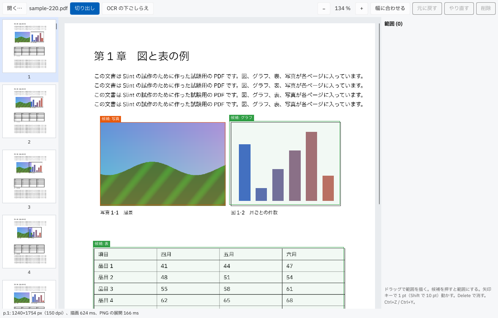
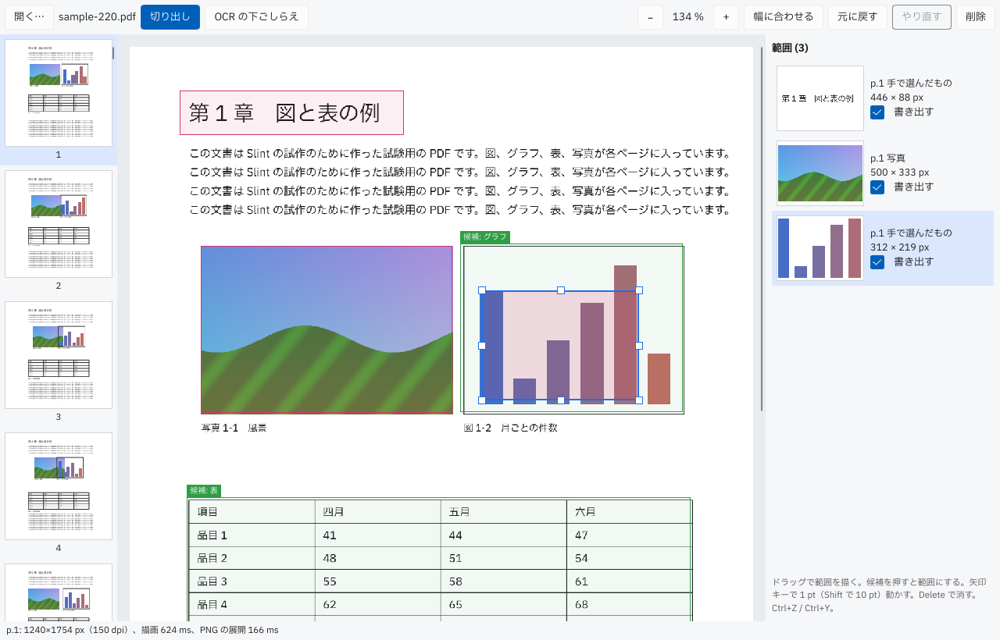
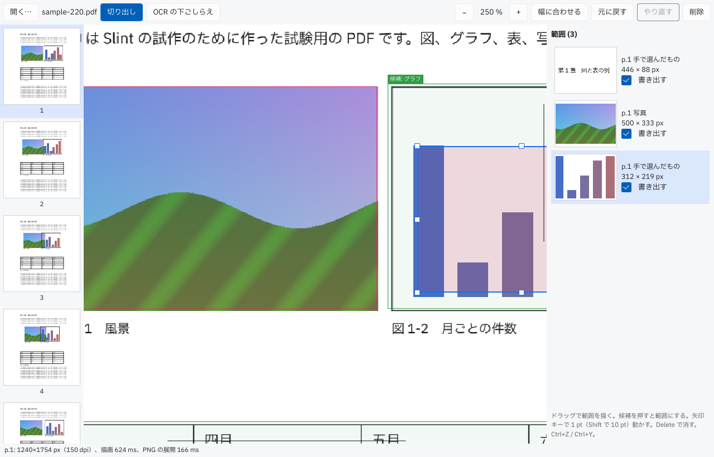
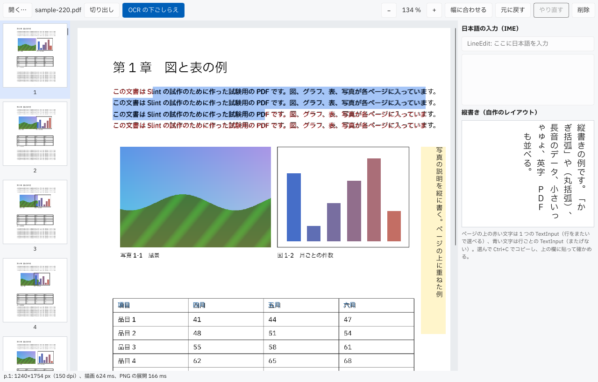
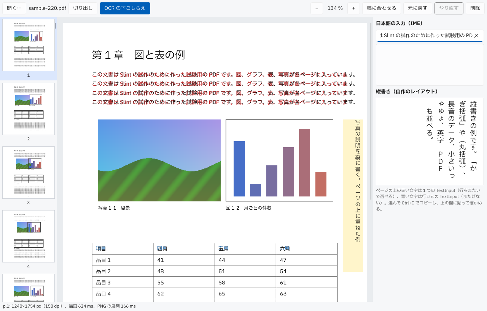
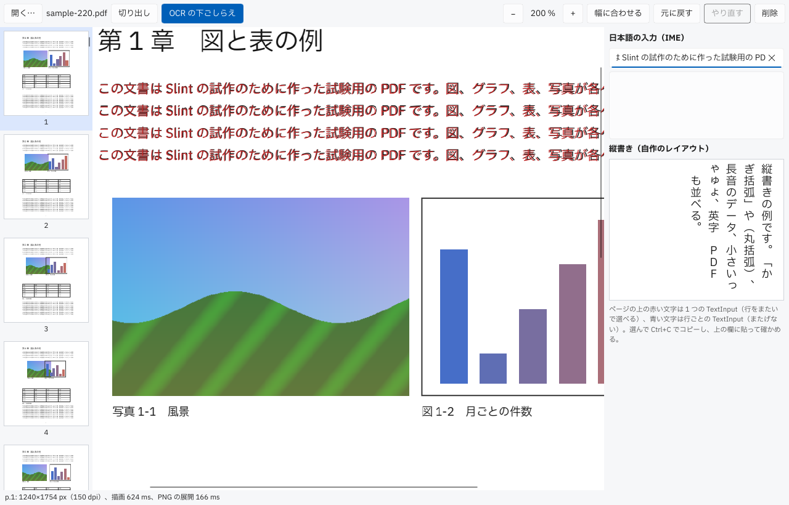

# Slint 試作の報告（担当 B: 切り出しの画面と OCR の下ごしらえ）

- ブランチ: `spike/slint-crop`（マージしない）
- Slint: **1.18.1**（2026-11-04 に crates.io を見て選んだ。最新の安定版で、2026-10-16 の比較のときと同じ版）。スタイルは `fluent`。
- 動かし方と前提: [README.md](README.md)
- 確かめた環境: クラウドの Linux（画面なし）。`Xvfb` の上で `winit` + ソフトウェアの描き方（`SLINT_BACKEND=winit-software`）で動かし、`Window::take_snapshot()` で画面の画像を取った。操作は `Window::dispatch_event` で本物のポインターとキーのイベントを送った（[src/shots.rs](src/shots.rs)）。
- `cargo build` と `cargo test`（単体 12 件、窓を使う試験 5 件）が通る。

## 1. 骨組み

**判定: そのままできる**

- 1 つの窓に、左にページのサムネイルの一覧（`ListView`、220 ページ）、中央にページ、右に範囲の一覧（OCR のタブでは入力欄と縦書き）。上に道具のボタン、下に状態の行。
- フォントは IBM Plex Sans JP。`.slint` から `import "../fonts/IBMPlexSansJP-Regular.ttf";` して `default-font-family` に名前を書くだけで、日本語がすべてこのフォントで描かれた。npm の `@ibm/plex-sans-jp` には woff と woff2 しかなく、Slint（fontique / skrifa）は woff を読まないので、標準ライブラリだけの小さな変換（[tools/woff2ttf.py](tools/woff2ttf.py)、40 行）で TTF に戻した。製品にするなら TTF を同梱するか、ビルドで変換する。
- PDF は **worker で描いた**。試作の実行ファイルが `WORKER_FLAG` 付きで自分を起動し、`crates/worker` の `WorkerProcess` に `Open`・`Render`・`Thumbnail`・`PageImages`・`Detect` を送る（[src/pdf.rs](src/pdf.rs)、約 180 行）。`src-tauri` と同じ形で、つなぐ手間はほとんどなかった。ページ用とサムネイル用に worker を 2 つ動かし、答えは `slint::invoke_from_event_loop` で UI のスレッドに戻す（`slint::Image` は `Send` でないので、画素の `Vec<u8>` を渡して UI のスレッドで `Image` にする）。
- 候補は本物: `PageImages` の写真の範囲と、`Detect`（同梱のレイアウトのモデル）の図・グラフ・表。
- 試験用の PDF は krilla で作った 220 ページ（[src/bin/gen_pdf.rs](src/bin/gen_pdf.rs)）。各ページに日本語の文字、埋め込みの画像、ベクターの棒グラフ、表がある。
- OS からのファイルの D&D は、1.18.1 でも `DropArea` には来ない（`DropArea` はアプリの中の D&D 用。[#11400](https://github.com/slint-ui/slint/issues/11400) で入ったもの）。2026-10-16 と同じく `unstable-winit-030` 機能の `on_winit_window_event` で `DroppedFile` を受けた（[src/main.rs](src/main.rs) の `install_file_drop`）。winit の窓にファイルをドラッグすると落ちるという未解決の報告がある（[#12437](https://github.com/slint-ui/slint/issues/12437)）ので、Windows で確かめてほしい（下の「オーナーが確かめること」）。
- ファイルのダイアログは `rfd`（「開く…」のボタン）。

## 2. 切り出しの範囲の編集

**判定: 工夫すればできる**（心配した「自作」は、HTML でも自作している範囲を超えなかった）

### どう作ったか

| 部分 | 場所 | 行数（おおよそ） |
| --- | --- | --- |
| 範囲の計算・ジェスチャーの状態・履歴（`cropEdit.ts`・`useAreaDrag.ts`・`CropHistory` に当たる） | [src/edit.rs](src/edit.rs) | 290（試験を除く） |
| 窓とのつなぎ（モデルの更新、キー、プレビュー、worker） | [src/app.rs](src/app.rs) | 330 |
| ページ・候補・範囲・つまみの描画とイベント（`CropPagePane.tsx`・`CropOverlays.tsx` に当たる） | [ui/app.slint](ui/app.slint) の page-view の部分 | 230 |
| 窓を使う試験 | [tests/ui.rs](tests/ui.rs) | 60 |

- **ページの描画・拡大と縮小・幅に合わせる・スクロール**: そのままできる。`ScrollView` の中にページの `Rectangle` を置き、幅と高さを `page-w * zoom` にするだけ。範囲と候補は pt で持ち、`.slint` の側で `* zoom` して置くので、拡大しても座標の変換を Rust に書かずに済む。`ScrollView` はマウスのドラッグでスクロールしない設定が既定（`mouse-drag-pan-enabled: false`）なので、ページの上のドラッグと取り合わない。
- **候補の枠**: 写真の範囲（橙）と、レイアウトの解析の候補（緑）を重ねた。押すと範囲になり、採用した候補は隠す（`visible: false` の要素はイベントも受けない）。
- **ドラッグで新しい範囲**、**移動**、**角と辺の 8 つのつまみでの大きさの変更**、**選ぶ**、**消す（Delete）**、**矢印キーで 1 pt（Shift で 10 pt）**、**Ctrl+Z / Ctrl+Y**: すべてできた。キーは `FocusScope` の `key-pressed` で受ける。
- **プレビュー**: 範囲の中を、すでに描いたページの画素から切り取って右の一覧に出す（[src/pdf.rs](src/pdf.rs) の `crop`）。worker に頼まないので、ドラッグの最中も追いつく。
- **元に戻すとやり直し**: 範囲全体の写しを積む簡単な履歴。1 回のドラッグは 1 つの手順になる（押した時点ではなく、実際に動いた時点で記録する）。

上の画像では、見出しを手で囲み、写真の候補を押して範囲にし、グラフの候補の上から手で描いた範囲を、重なった所でドラッグして動かし、右下のつまみで広げ、矢印キーで 1 pt 動かしている（どれも本物のポインターのイベントで操作した）。

### 手で描いた範囲が候補に重なったとき

**Slint では、どちらが上で受けるかを決められる。** 今の React 版で動かなかった「重なった所をドラッグして手で描いた範囲を動かす」は、ここでは動いた。

- Slint のポインターのイベントは、指した位置にある要素のうち **木の中で後ろにあるもの（上に描かれるもの）から順に** 渡り、`TouchArea` が受け取るとそこで止まる。押した `TouchArea` は離すまでポインターをつかみ続ける（ドラッグの途中で範囲の外に出ても動き続ける）。
- そこで、ページ（新しい範囲を描く）→ 候補 → 手で描いた範囲 → 選んだ範囲のつまみ、の順に並べた。重なった所では手で描いた範囲が受ける。順番を変えずに上下を変えたいときは、兄弟の要素どうしなら `z` で決められる。
- 試験で確かめた: [tests/ui.rs](tests/ui.rs) の `manual_range_over_candidate_takes_the_drag` は、候補の上に範囲を置き、重なった所を押して動かすと、範囲が動き、候補は採用されないことを確かめる。候補に `z: 10` を付けると、この試験は落ち、押した所から新しい範囲が描かれた（候補が上で受けたため）。つまり上下は宣言の順と `z` で決まり、思ったとおりに制御できる。
- 合成のイベントの順番に悩まずに済むのは、HTML より良い点だった。

### 突き当たった Slint の制約

- **モデルを丸ごと入れ替えると、ドラッグが切れる。** `for` で並べた要素は、モデルを新しい `VecModel` にすると作り直され、ポインターをつかんでいた `TouchArea` も消える。行の数が変わらないときは `set_row_data` で行だけを書き換えるようにした（[src/app.rs](src/app.rs) の `sync`）。知っていれば難しくないが、React の「状態を作り直せば描き直される」感覚のままだと踏む。
- **破線の枠がない。** `Rectangle` の枠は実線だけで、`Path` にも破線の指定がない（1.18.1 の `builtin_elements.rs` に dash の属性がない。要望は [#6008](https://github.com/slint-ui/slint/issues/6008)、閉じた理由は確かめていない）。候補は薄い塗りと実線の枠で区別した。破線が要るなら、短い `Rectangle` を並べるか、`Image` に描いて敷く。
- **ラベルの文字の幅に合わせた背景**は `preferred-width` で作れたが、HTML の inline 要素のような自動の大きさではない。
- **座標の変換**は、`TouchArea` の `mouse-x` が自分の左上からの位置なので、要素ごとに「自分の位置 + mouse-x」を pt に戻す式を書いた（`absolute-position` も使える）。

## 3. OCR の下ごしらえ

### 3.1 ページの上の決まった位置に文字を重ねる

**判定: そのままできる**

- `TextInput` を `read-only: true` にして、ページの文字の位置に置いた。1 つの段落（4 行）を 1 つの `TextInput` にまとめ、最初の行の基線を PDF の基線（105 pt）に合わせ、`line-height-factor` で行の間隔を PDF の 18 pt に合わせると、赤い重ねた文字が元の黒い文字とほぼぴったり重なった（下の画像）。
- 制約: `TextInput` 自身の `font-metrics` を `line-height-factor` の式に使うと、実行時に「Recursion detected」で落ちた（コンパイラーは気付かない）。見えない `Text` を別に置いて、その `font-metrics` を使った。

### 3.2 重ねた文字をマウスで選んでコピーする

**判定: 1 つの塊の中なら「そのままできる」、塊をまたぐなら「自作が要る」**

- 1 つの `TextInput` の中では、何行にもまたがる選択ができ、Ctrl+C でコピーできた。試作の自動の操作では、1 行目の途中から 3 行目の途中までをドラッグで選び、Ctrl+C でコピーし、`LineEdit` に Ctrl+V で貼った。貼られた文字は 3 行分（改行は 1 行の欄なので空白になった）で、クリップボードを通った往復ができた。
- 行（または単語）ごとに別の `TextInput` を置くと、選択はその中で止まり、またげない（青い文字の表の見出し）。
- OCR の結果は「単語か行ごとの枠と文字」になるので、ページ全体で自然に選ぶには、**塊をまたぐ選択を自作する** ことになる。Slint には、文字の位置を調べる（ある点が何文字目か、何文字目がどこか）公開の API がない（`Text` の文字の寸法を出す要望 [#6283](https://github.com/slint-ui/slint/issues/6283) は未解決）。自作するなら、Rust の側で同じフォントで字形を並べ（例: `parley` や `rustybuzz`）、選択の矩形を自分で計算して `Rectangle` で塗り、クリップボードへは `arboard` などで書く。見積もりは 600〜1000 行。HTML なら、透明な文字を `position: absolute` で置くだけでブラウザーが選択とコピーをしてくれる（pdf.js の text layer と同じ）ので、**ここは心配が当たった**。
- 次善の策: 段落や表のセルのように、同じ左端と行の間隔を持つ塊ごとに 1 つの `TextInput` にまとめれば、塊の中の何行にもまたがる選択はそのままできる。OCR の結果を塊にまとめる前処理（段落の検出）は、どのみち要る。

### 3.3 日本語の縦書き

**判定: 自作が要る**（ただし、表示だけなら小さい）

- Slint の `Text` と `TextInput` には書字方向（`writing-mode`）がない。字形の縦の形（OpenType の `vert`）も使わない。Slint の issue を探したが、縦書きの要望は見つからなかった。
- 表示だけなら自作した（[src/vtext.rs](src/vtext.rs) 約 70 行と、`.slint` の `VerticalText` 約 20 行）: 1 字ずつ `Text` を置き、右の列から左へ並べる。句読点と括弧は Unicode の縦書き用の字（U+FE10〜、U+FE30〜）に置き換え、長音と英数字は `transform-rotation: 90deg` で回し、小さい仮名と句読点は升の右上に寄せ、行頭に来てはいけない字は前の列にぶら下げる。Plex Sans JP は縦書き用の字を持っていた。下の画像の右の欄と、ページの右端の黄色の帯。
- 足りないもの: 縦書きの中の選択と入力（カーソルの移動も選択の矩形も縦向きに自作）、和欧混植の細かい規則（縦中横、半角の英字を 1 字ずつ立てるか回すか）、ルビ。これを全部作るのは大きい（選択まで入れて 1000 行を超える見込み）。HTML なら `writing-mode: vertical-rl` だけで選択も入力も付いてくるので、**ここも心配が当たった**。表示だけで足りる（縦書きの OCR の結果を見せる、選ぶのは横書きの一覧で行う）なら、今の自作で済む。

### 3.4 `LineEdit` と `TextEdit` での日本語の入力（IME）

**判定: オーナーが確かめる**（クラウドでは確かめられない）

- OCR のタブの右上に `LineEdit` と `TextEdit` を置いた。2026-10-16 の比較では `LineEdit` で IME が使えた。未解決の報告として、変換の途中で窓のフォーカスが外れると最後の 1 字が落ちる（[#10861](https://github.com/slint-ui/slint/issues/10861)）がある。

## 4. 重さ

（このあと書く）

## オーナーが確かめること（Windows）

### 前提

1. Rust（`rust-toolchain.toml` の版が自動で入る）、Node.js 24.15 以上、Python 3。
2. リポジトリの直下で `npm run pdfium:fetch` と `npm run layout:fetch`。pdfium は `src-tauri\pdfium\windows\bin\pdfium.dll`、onnxruntime は `src-tauri\onnxruntime\windows\onnxruntime.dll`、モデルは `src-tauri\layout-model\` に置かれ、試作はそこを見る。
3. [README.md](README.md) の手順でフォントを TTF にして `slint-spike\fonts\` に置き、`cargo run --release --bin gen-pdf` で試験用の PDF を作る。
4. `cd slint-spike` で `cargo run --release -- testdata\sample-220.pdf`。描き方を比べるときは、PowerShell で `$env:SLINT_BACKEND="winit-software"` または `"winit-femtovg"` を設定してから動かす。

### 手順

1. **範囲の編集の手ざわり**: ページの空いた所をドラッグして範囲を描く。範囲を動かす。8 つのつまみで大きさを変える。候補（緑と橙の枠）を押して範囲にする。グラフの候補の上に手で範囲を描き、重なった所をドラッグして、手で描いた範囲が動くこと（候補が範囲にならないこと）。矢印キー、Shift+矢印、Delete、Ctrl+Z、Ctrl+Y。マウスの形がつまみごとに変わること。
2. **拡大とスクロール**: 「+」「−」「幅に合わせる」、ホイールでのスクロール。`--dpi 300` を付けて同じことをし、重さを比べる。
3. **OCR のタブ**: 赤い文字を 2 行以上にまたがってドラッグで選び、Ctrl+C、右上の `TextEdit` に Ctrl+V。青い文字（表の見出し）は 1 つずつしか選べないこと。
4. **IME**: 右上の `LineEdit` と `TextEdit` に、Microsoft IME で日本語を入れる。変換の候補の窓が入力の位置に出るか、確定、変換の途中での Backspace、変換の途中で別の窓に切り替えたときに字が落ちないか（#10861）。
5. **OS からの D&D**: エクスプローラーから PDF を窓に落とすと開くこと。落としたときにアプリが落ちないこと（#12437）。
6. **スクリーンリーダー**: ナレーターを点け、ボタン、範囲の一覧のチェックボックス、`LineEdit` が読まれるか。ページの上の範囲は読まれない（試作では読み上げの情報を付けていない）。
7. **縦書き**: OCR のタブの右下の縦書きが、句読点・括弧・長音・小さい仮名を正しい向きと位置で表示するか。
