# Slint 試作の報告（担当 A: 整理の画面と OS とのつなぎ）

- ブランチ: `spike/slint-organize`（main の 97309b3 から）。マージしない前提。
- Slint: **1.18.1**（crates.io の最新の安定版。2026-11-04 に crates.io の索引で確かめて選んだ。2026-10-16 の比較と同じ版で、その後の新しい版は出ていない）。`slint-build` も `=1.18.1` に固定。
- 確かめた環境: クラウドの Linux（画面なし）。`Xvfb` の上で、Slint のソフトウェアの描き方（`SLINT_BACKEND=winit-software`）で動かし、`Window::take_snapshot()` で画像にした。
- 毎回 `cargo build` と `cargo test`（`src/organize.rs` の単体テスト 10 本）を通した。画面の操作は `src/scenario.rs` が `Window::dispatch_event`（本物のマウスとキーと同じ入口）で流し、結果をログと画像で確かめた。

## 動かし方

```bash
cd slint-spike
./scripts/fetch-font.sh          # Plex Sans JP を fonts/ に（git で追跡しない）
cargo run --bin make_sample      # samples/pages-240.pdf（240 ページ）を作る
cargo run -- samples/pages-240.pdf
./scripts/screenshots.sh         # Xvfb で台本を流し、screenshots/ に画像を書く
```

- pdfium は、リポジトリの直下で `npm run pdfium:fetch` を実行したあとの `src-tauri/pdfium/linux/lib`（Windows は `src-tauri/pdfium/windows/bin`）を見る。環境変数 `PDFIUM_DIR` で変えられる。
- worker は別のバイナリにせず、この試作のバイナリを `--worker <pdfium のフォルダ>` で起こし直して `pdfconv_worker::server::run` を呼ぶ（`src/main.rs` の `main`）。レイアウトの検出は使わないので、onnxruntime とモデルの道は渡すだけで開かれない。
- フォント: npm の `@ibm/plex-sans-jp` には WOFF / WOFF2 しか入っていない。Slint の `import "….ttf"` は TTF / OTF を受けるので、`scripts/woff2ttf.py`（Python の標準ライブラリだけで WOFF 1.0 を TTF に戻す）で変換する。
- 試す PDF: `src/bin/make_sample.rs` が `pdfconv_core::PdfWriter` で作る（240 ページ、7 ページごとに横向き）。ライセンスはこのリポジトリと同じ。

## 1. 骨組み — 判定: そのままできる

- 作り: [`ui/app.slint`](ui/app.slint)（窓・上のタブ・言語の切り替え。172 行）、[`ui/tokens.slint`](ui/tokens.slint)（`src/styles/tokens.css` の色を写したもの。45 行）、[`translations/ja/LC_MESSAGES/slint-spike.po`](translations/ja/LC_MESSAGES/slint-spike.po)（日本語。`src/i18n/ja.ts` から 25 個ほど写した）。
- 色: `global T` に明るい・暗いの 2 組を置き、`Palette.color-scheme`（OS の設定）で切り替える。CSS の custom properties とほぼ同じ書き味。PDF ごとの色（`--organize-source-1〜6`）も配列で持てた。
- フォント: `import "../fonts/IBMPlexSansJP-Regular.ttf";` と `default-font-family: "IBM Plex Sans JP";` だけで、ソフトウェアの描き方でも日本語がきれいに出た（画像 01）。フォントはバイナリに埋め込まれる（1 書体 5.7 MB。3 書体で 17 MB ほど増える。今のアプリの woff2 より大きい。分割した woff2 を使う手はない）。
- 言語: `@tr("…")` と `slint_build::CompilerConfiguration::with_bundled_translations("translations")`、実行時に `slint::select_bundled_translation("ja" | "en")`。窓を作り直さずに、その場で全部の文言が切り替わった（画像 01 → 10）。複数形も `@tr("{n} page" | "{n} pages" % count)` で書け、日本語は `nplurals=1` で 1 つにできた。
  - 注意: 翻訳の文脈（`msgctxt`）は既定で**部品の名前**になる。同じ英語でも部品ごとに `.po` の項目が要る（`"{n} page"` が `Chip` と `OrganizeView` の 2 つ）。今回は手で `.po` を書いた。本番では `slint-tr-extractor` で `.pot` を抜き出す流れになる。
  - 今の `src/i18n/` のように「キー → 文言」ではなく「英語の原文 → 訳」になる。キーの型の検査（`Translations` 型）はなくなり、訳し漏れは英語のまま出る。
- 突き当たったこと:
  - 破線の枠がない（`border-style` がない）。ドロップの場所の破線は実線にした（画像 00）。
  - `ScrollView` の `viewport-*` は 1.18 で非推奨になり `content-*` に改名されていた（警告で分かる）。

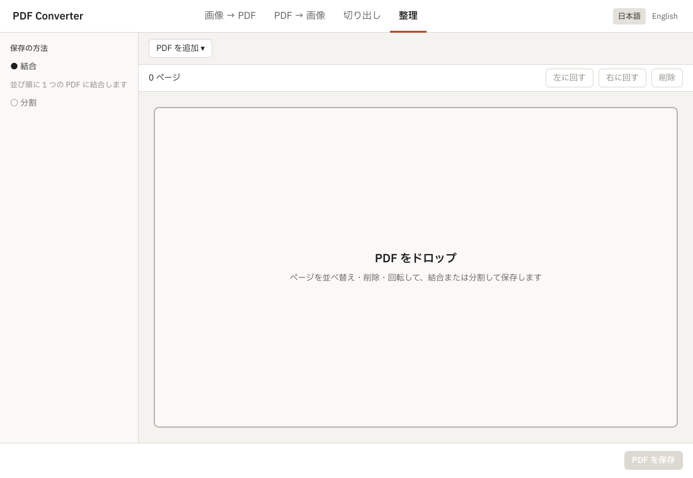

## 2. 整理のサムネイルの格子 — 判定: 自作が要る（ただし手間は小さく、性能の心配は当たらなかった）

**結論を先に**: 心配したとおり、HTML ならブラウザーと数行の CSS がくれるもの（折り返す格子、見えている所だけを描く仕組み、ドラッグの当たり判定、差し込みの線、端での自動のスクロール）は Slint には部品がなく、**全部を自作した**。ただ、今の React の画面もこの部分はすでに自作（`organizeGrid.ts` が升の大きさを固定して見えている行だけを描き、`useOrganizeDrag.ts` がポインターのイベントで並べ替えている）なので、**自作の量は React とほぼ同じ**だった。むしろ、状態と幾何をすべて Rust に寄せたので、テストは書きやすくなった。手ざわりと速さは、Linux の画面なしで測った範囲では問題なかった。

### どう作ったか

| 部分 | ファイル | 行数 |
| --- | --- | --- |
| 状態と幾何（選択・並べ替え・取り消し・列の数・見えている範囲・差し込む位置・自動のスクロールの速さ）と単体テスト | [`src/organize.rs`](src/organize.rs) | 554（テスト 180） |
| 画面とのつなぎ（升の使い回し、ポインター、キー、サムネイルの受け取り） | [`src/main.rs`](src/main.rs) の `Ctx` | 約 450 |
| worker への問い合わせ（サムネイル・開く・保存） | [`src/thumbs.rs`](src/thumbs.rs) | 236 |
| 格子・升・札・帯・下部バーの見た目 | [`ui/organize.slint`](ui/organize.slint) | 約 500 |
| 画面なしで操作を流す台本 | [`src/scenario.rs`](src/scenario.rs) | 336 |

参考: 今の React の整理の画面は `src/features/organize/` で約 7,900 行（テスト込み）。この試作は分割・パスワード・通知などを含まないので、行数は比べられない。

#### 窓の幅で列の数を変える

- Slint には折り返す格子（CSS の `grid-template-columns: repeat(auto-fill, …)` や flex-wrap）がない。`GridLayout` は行と列を自分で書く静的な配置で、モデルから升を並べて折り返すことはできない。
- そこで升の位置（`x`, `y`）を Rust で計算して渡す（`organize::column_count`・`cell_origin`）。`ScrollView` の `visible-width` が変わると `changed visible-width => layout-changed()` が呼ばれ、Rust が列の数を数え直す。今の `organizeGrid.ts` と同じ式・同じ大きさ（升 124 px、間 16 px / 18 px）。
- 結果: 1,100 px で 6 列、720 px で 3 列（画像 01、09）。

#### 200 ページ以上でも重くしない（見えている所だけを描く）

- Slint の `ListView` は縦 1 列の行を仮想化するだけで、格子には使えない（升を行ごとにまとめて `ListView` に入れる手もあるが、列の数が変わるたびに行の作り直しになり、ドラッグの最中に行が消えるとポインターの捕捉も失う）。
- そこで自前で仮想化した。`ScrollView` の中身の高さだけを全ページ分にし、`for cell in cells` の `cells` には**見えている行と上下 2 行の分の升だけ**を入れる。升は使い回す（ページの番号 → 升の番号の表を持ち、画面から出た升を空きにして、入ってきたページに渡す）。データが変わった升だけ `set_row_data` するので、Slint が描き直すのもその升だけ。
- 測った値（台本のログ。デバッグビルド、ソフトウェアの描き方、4 コア）:
  - 240 ページで、作られた升は最大 60 個（最初の画面は 42 個）。ページが増えても升の数は変わらない。
  - 中身の高さ全体を 120 px ずつ 56 回動かしたときの Rust 側の計算: 合計 10 ms（1 回 0.2 ms 以下）。
  - 開いてから最初の画面のサムネイル 42 枚が揃うまで: 約 0.7〜0.8 秒（worker 2 つ）。60% の位置に飛んで揃うまで: 約 1.0 秒。
- 描き方の速さ（フレームの時間）は画面なしでは測れていない。Windows でスクロールの手ざわりを確かめてほしい（「オーナーが確かめること」）。

#### サムネイルを描けたものから差し替える（画面を止めない）

- `ThumbService`（`src/thumbs.rs`）が worker を 2 つ持ち、それぞれ別のスレッドで `Open` と `Thumbnail` を投げる。PNG はそのスレッドで解いて `SharedPixelBuffer` にし、`slint::Weak::upgrade_in_event_loop` で UI のスレッドに渡す。UI のスレッドは `Image::from_rgba8` で升に入れるだけ。
- 待ち行列は「新しい要求から先に」。画面に見えている (PDF, ページ) の組を毎回 worker 側に渡し、worker が取り出す時点で画面から消えていれば捨てる（今のアプリの `ORGANIZE_THUMBNAIL_DELAY_MS` で待ってから頼む仕組みと同じ狙い）。
- 一度取った絵は 1,000 枚まで覚える（`THUMB_CACHE_PAGES`。今のアプリの `ORGANIZE_THUMBNAIL_CACHE_PAGES` と同じ）。
- 回転: 今のアプリと同じく描き直さず、画面で回して見せる。ただし**ソフトウェアの描き方は `transform-rotation` を無視する**（`i-slint-renderer-software` の `fn rotate` が空で `// TODO (#6068)` とある。slint-ui/slint#6068）。GPU の描き方（femtovg / skia）では回るが、描き方によって見た目が変わるのは困るので、Rust で画素を 90° 単位に回した絵を作って覚えておく形にした（`Thumb::image`）。画像 03。

#### クリック、Shift / Ctrl のクリックで複数を選ぶ

- 格子全体を 1 つの `TouchArea` で受け、`pointer-event` の `modifiers.shift` / `modifiers.control` と、押した位置から Rust が升を当てる（`Ctx::hit_test`）。選択の規則は `Organizer::press` / `click_released`（Explorer と同じく、選んである升を修飾なしで押したときは、ドラッグに備えて離すまで選択を絞らない）。
- 台本: 2 番目をクリック → 4 番目を Shift+クリック → 9 番目を Ctrl+クリックで 4 ページが選ばれた（画像 02）。

#### ドラッグで並べ替える（差し込む線・複数・端での自動のスクロール）

- Slint 1.18 には `DragArea` / `DropArea` があるが、これは「データを運ぶ」ための仕組み（`data-transfer`）で、並べ替えの差し込む位置の計算や線は出してくれない。HTML でも並べ替えは自作するのが普通（今のアプリもポインターのイベントで自作）なので、同じ作りにした。
- 押した位置から 4 px 動いたらドラッグを始める。`organize::drop_target` が、ポインターの位置から「どの升の前に入れるか」と線の位置を返す。行の右端より右では、次の行の先頭ではなく、その行の末尾に線を出す（設計 organize §4 の区切りの線と同じ考え）。動かしているページは薄くし、ポインターの横に「4 ページ」の札を出す（画像 04）。
- 複数を選んだまま動かすと、選んだページが元の順のまま 1 かたまりで入る（`Organizer::move_pages`）。台本では p.2〜p.4 と p.9 を 13 番目の前に落とし、`[1, 5, 6, 7, 8, 10, 11, 12, 2, 3, 4, 9, 13, …]` になった（画像 05）。
- 端での自動のスクロール: ポインターが格子の上下 40 px に入ると、`slint::Timer`（16 ms ごと）で中身を動かし、端に近いほど速くする（`drag_scroll_step`。今のアプリの `ORGANIZE_DRAG_SCROLL_EDGE_PX` / `…_MAX_STEP_PX` と同じ値）。ポインターが止まっていても差し込む位置を数え直す。台本では下の端で 1.5 秒止めて 1,060 px ほど進んだ（画像 07）。
- `TouchArea` はボタンを押している間ポインターを捕まえるので、窓の外まで動かしても `moved` が届く。升を使い回して画面から消えても、捕まえているのは格子全体の `TouchArea` なので切れない（升ごとに `TouchArea` を置くと、自動のスクロールで升が消えたときにドラッグが切れる）。
- `ScrollView` はデスクトップではマウスのドラッグで中身を動かさない（fluent の `ScrollView` の `mouse-drag-pan-enabled: false`）ので、並べ替えのドラッグとぶつからない。

#### キーボード

- 格子を `FocusScope` で包み、`key-pressed` を Rust に渡す（`Ctx::grid_key`）。今のアプリの `useOrganizeGridKeys.ts` と同じ割り当て:
  - 矢印で移る（上下は 1 行）、Home / End、Shift+矢印で選択を広げる、Space で入れ外し、Esc で選択を外す、Ctrl+A ですべて。
  - Alt+矢印で選んだページを 1 つ（上下は 1 行）動かす。R / L で回す。Delete / Backspace で削除。Ctrl+Z / Ctrl+Y（Ctrl+Shift+Z）で取り消し・やり直し。
  - フォーカスのある升が画面の外に出たら、見える所まで動かす（`Ctx::reveal`）。
- 台本: Home → → → Shift+→ → Alt+→ で `[1, 5, 8, 6, 7, …]`、Ctrl+Z で元に戻った（画像 06）。フォーカスの升は濃い枠（格子にフォーカスがあるときだけ）。
- 注意: 升そのものはフォーカスを持たない（格子の `FocusScope` が 1 つだけ持ち、どの升が「今の升」かは Rust の状態）。これはスクリーンリーダーに効く（項目 4）。

### 突き当たった Slint の制約

- 折り返す格子・仮想化した格子の部品がない（`ListView` は縦 1 列、`GridLayout` は静的）。大きな画像の格子の例を求める issue が開いたまま（slint-ui/slint#12481 "Add large image grid example"）。
- ソフトウェアの描き方は `transform-rotation` を無視する（slint-ui/slint#6068。`i-slint-renderer-software-1.18.1/lib.rs` の `fn rotate`）。
- `DragArea` / `DropArea` は 1.18 で入ったばかりの「データを運ぶ」仕組みで、並べ替えには使えない（slint-ui/slint#11400 "Implement in-process drag-and-drop using a design that can be extended for cross-application support"）。
- 文字の幅で省略する（`overflow: elide`）は効くが、升の下の札の「ファイル名」は `max-width` で固定した。CSS の `min-width: 0` と flex の縮みのような「残りの幅に合わせて縮める」はレイアウトの stretch で書くことになる。

### 画像

| | |
| --- | --- |
| 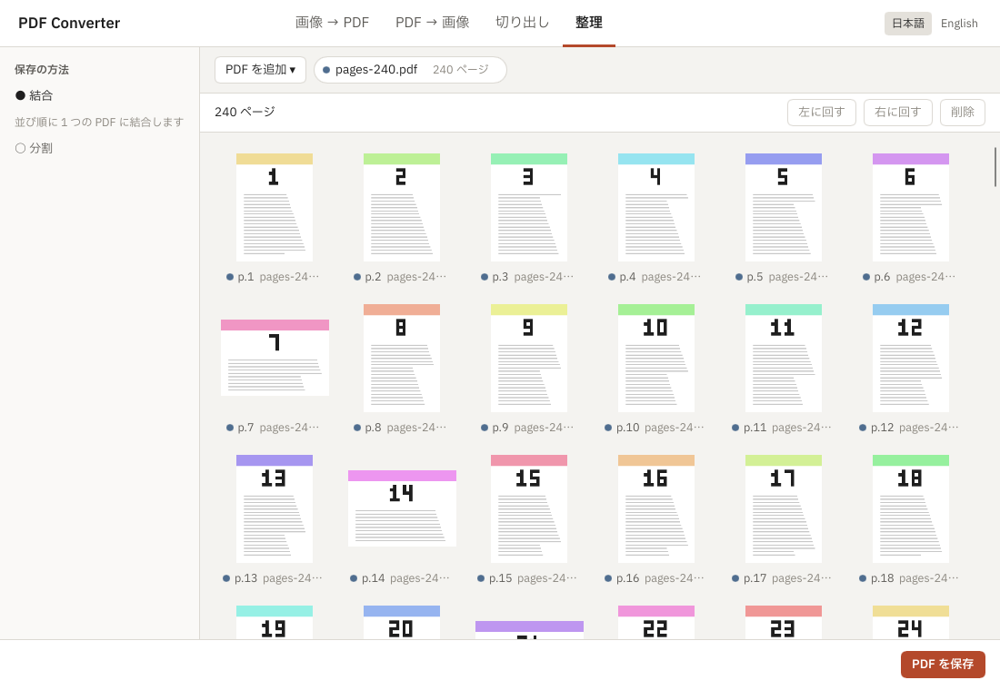 01 最初の画面（240 ページ、6 列） | 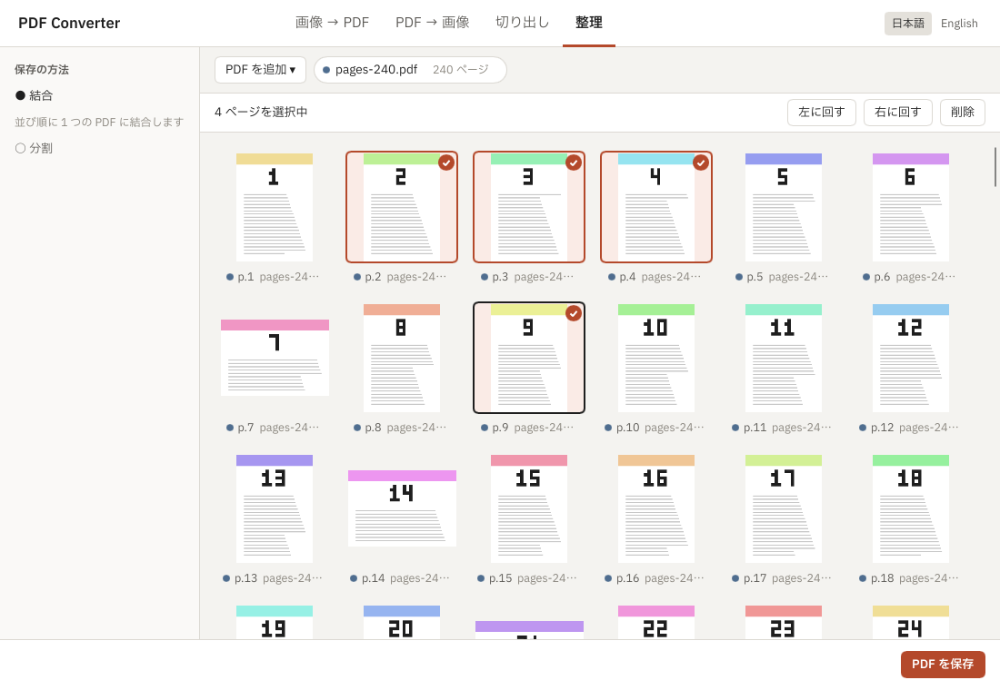 02 クリック・Shift・Ctrl で 4 ページ |
| 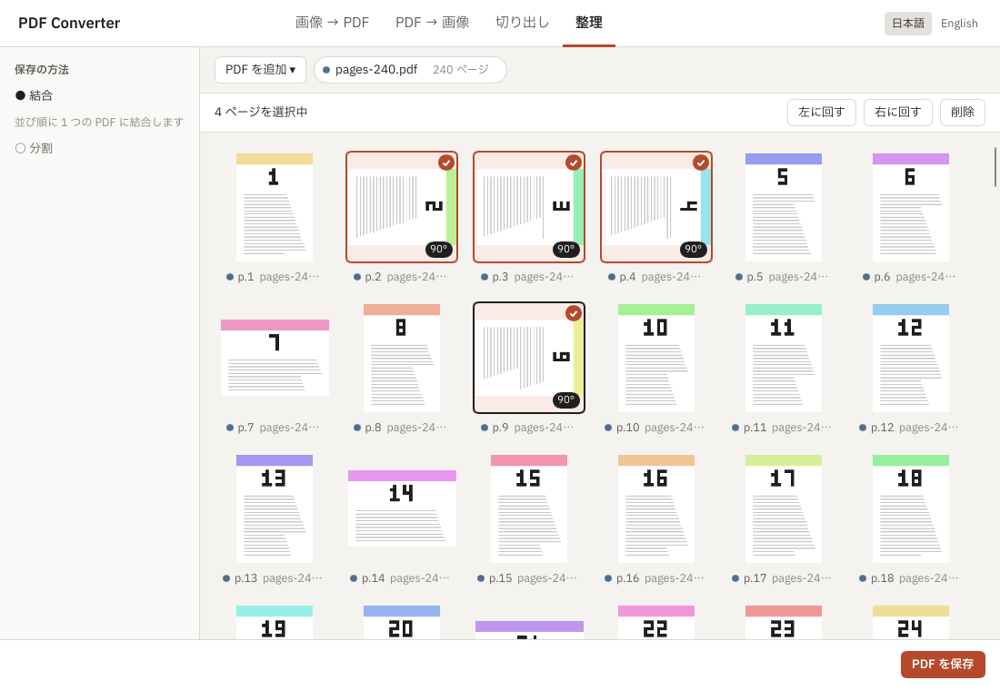 03 R で右に回した | 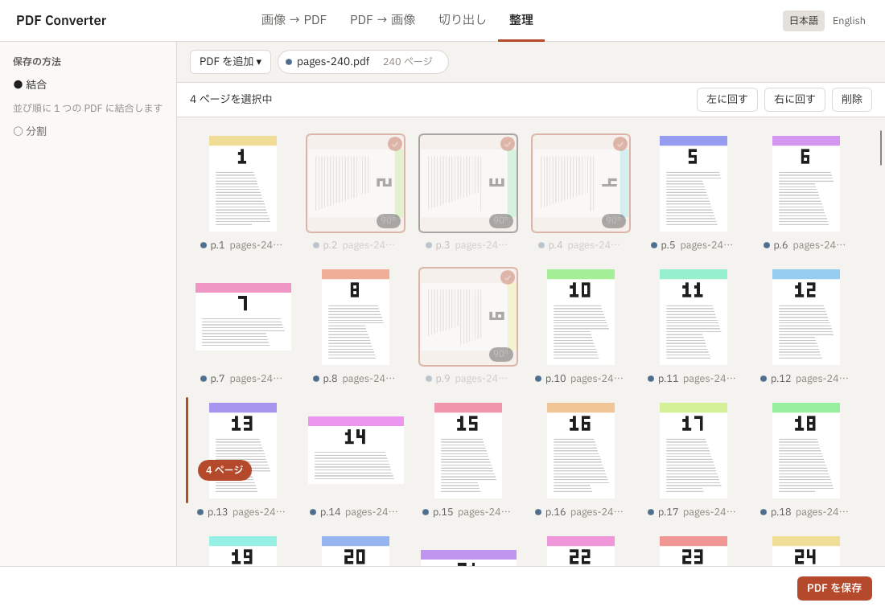 04 ドラッグの最中（差し込む線と札） |
| 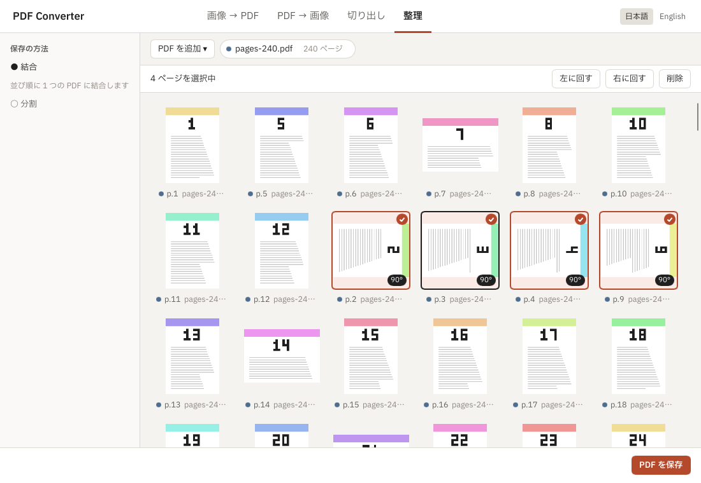 05 13 番目の前に落とした | 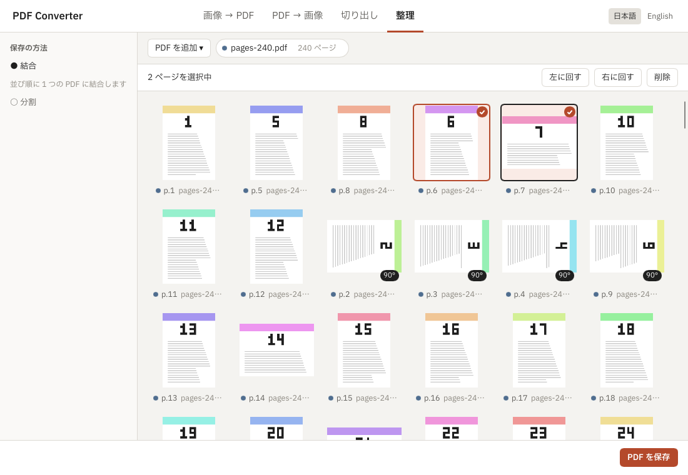 06 Alt+→ で動かした |
| 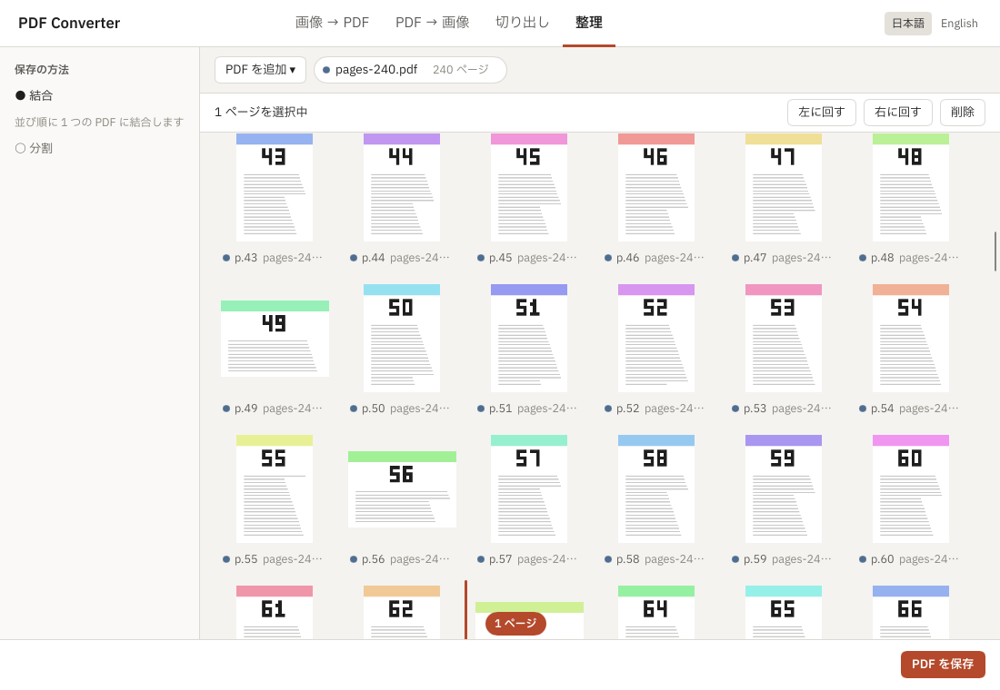 07 下の端で自動のスクロール | 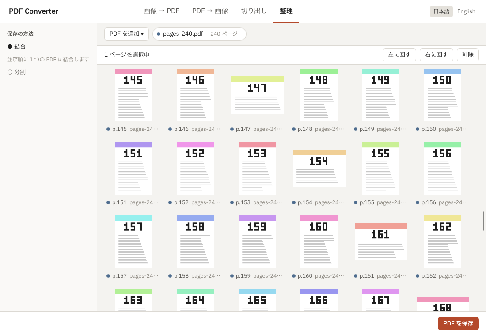 08 60% の位置に飛んだ |
| 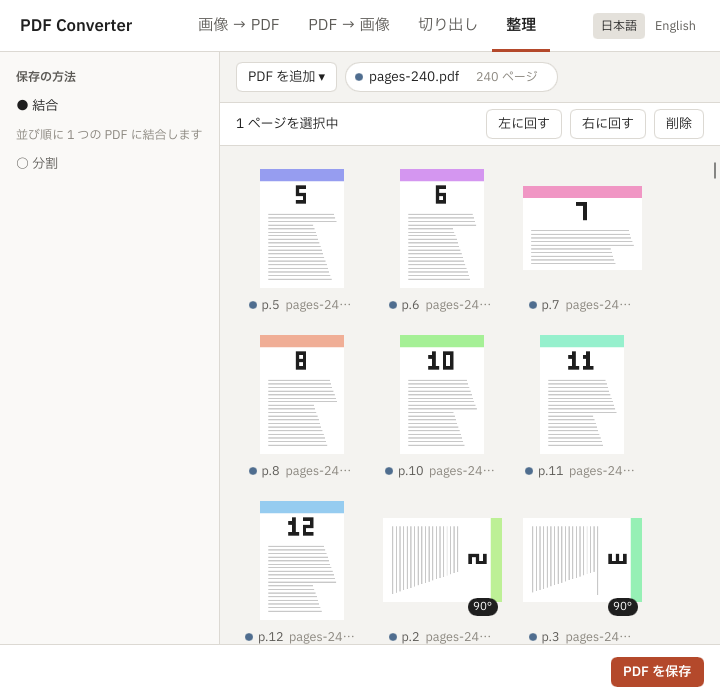 09 720 px で 3 列 | 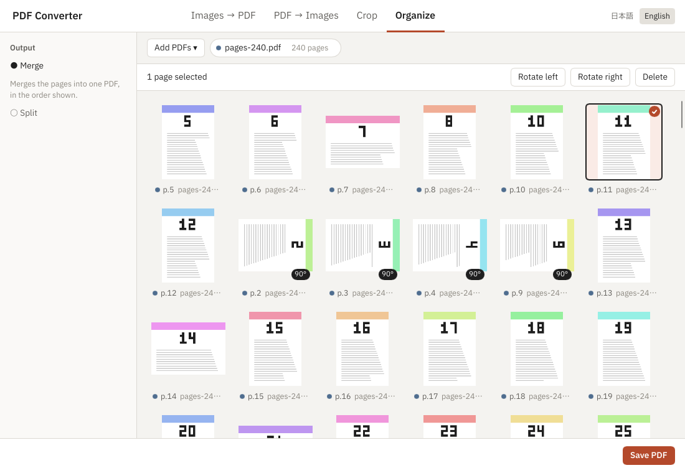 10 英語に切り替えた |
| 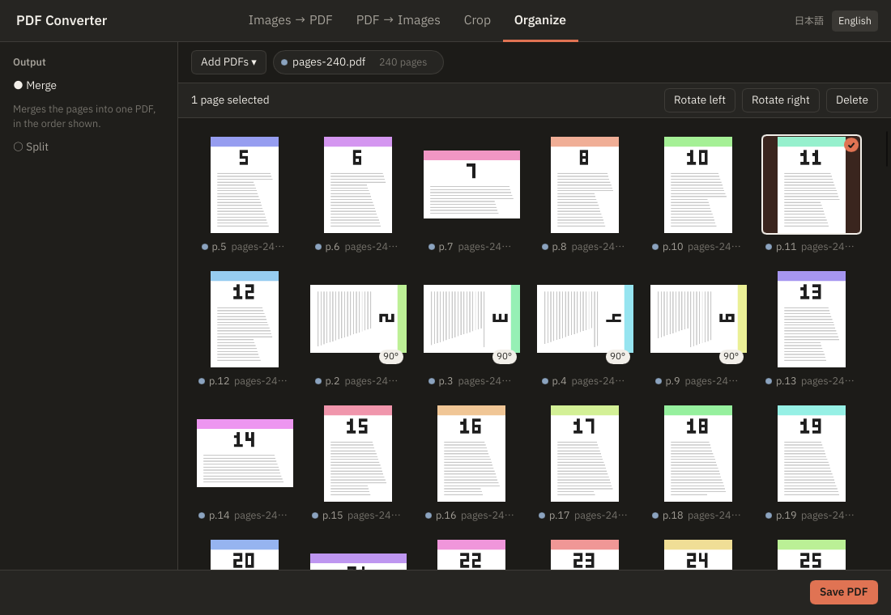 11 暗い色 | |

## 3. OS とのつなぎ

### ファイルのダイアログ — 判定: そのままできる

- 作り: [`src/main.rs`](src/main.rs) の `on_add_pdfs` / `on_save`（各 15 行ほど）。`rfd` 0.15.4 の `AsyncFileDialog` を `slint::spawn_local` の中で `await` する。`set_parent(&app.window().window_handle())`（slint の `raw-window-handle-06` 機能）で、ダイアログを窓の子にする。
- 開く: PDF の絞り込みで複数を選ぶ → 選んだ道を Rust がそのまま worker の `Open` に渡す。保存: 初期のファイル名を付けて保存先を選ぶ → 項目 5 の `Organize` で書き出す。
- 同期の `FileDialog` でも動くが、ダイアログの間イベントループが止まるので非同期の版にした。Windows の `rfd` は IFileDialog を別のスレッドで開く。
- Linux の `rfd` の既定は XDG デスクトップポータル（D-Bus）。このクラウドにはポータルがなく、ダイアログは出ずに `None` が返った。イベントループは止まらなかった（台本のログ「add-pdfs dialog: event loop still running」）。Linux で GTK のダイアログが要るなら `rfd` の `gtk3` 機能に替える（GTK の開発用ファイルが要る）。
- 今のアプリの決まり「道はダイアログと D&D からだけ Rust に入る」（design §1, §6.1）は、IPC がなくなるので自然に守られる。

### OS からのファイルの D&D — 判定: 工夫すればできる（2026-10-16 から変わらず）

- **最新の 1.18.1 でも `DropArea` は OS からのファイルを受けない。** 確かめた所:
  - `DragArea` / `DropArea` は 1.18 で入った（slint-ui/slint#11400 "Implement in-process drag-and-drop using a design that can be extended for cross-application support"）。名前のとおり**同じアプリの中**の D&D で、`DropArea` に届く `MouseEvent::DragMove` / `Drop` は、`DragArea` からのドラッグのときにだけ Slint の中で作られる（`i-slint-core-1.18.1/items/drag_n_drop.rs`）。
  - 外から入る口もない: 公開の `slint::platform::WindowEvent` にドラッグの種類はなく、内部の `InternalEvent` もマウス・キー・タッチだけ（`i-slint-core-1.18.1/platform.rs`）。winit のバックエンドは `WindowEvent::DroppedFile` / `HoveredFile` を扱っていない（`i-slint-backend-winit-1.18.1` に `DroppedFile` の文字列がない）。
- そこで前回と同じく、winit の窓のイベントを直接受ける（`slint::winit_030::WinitWindowAccessor::on_winit_window_event`、`unstable-winit-030` 機能）。`HoveredFile` で「PDF をドロップ」の覆いを出し、`HoveredFileCancelled` で消し、`DroppedFile(path)` で、ダイアログと同じ `add_paths` に渡す。[`src/main.rs`](src/main.rs) の 25 行ほど。覆いの見た目は画像 12。
- 工夫が要る点・危ない点:
  - `unstable-winit-030` は名前のとおり安定版の約束の外。Slint の版を上げると変わりうる。winit の版も Slint が決める（1.18.1 は winit 0.30.13）。
  - winit 0.30 の `DroppedFile` には**位置がない**（ファイルごとに道だけが届く）。「格子の、落とした位置に差し込む」はできない。今のアプリも整理では末尾に足す（organize §4）ので困らないが、位置で振り分ける画面を作るなら別の手（OS の API を直接）が要る。
  - フォルダを落とすと、フォルダの道が 1 つ届く。中の PDF を集めるのは自分で書く（今の `items.rs` と同じ）。試作では `.pdf` 以外を無視しただけ。
  - 開いたままの issue に slint-ui/slint#12437 "Crash when dragging file onto winit window." がある（題だけ読んだ。中身は確かめていない）。Windows で必ず試してほしい。
  - 画面なしの Xvfb には D&D の送り手がないので、`DroppedFile` の道筋はここでは動かしていない（`add_paths` から先は台本で通っている）。


## 4. アクセシビリティ

（未記入）

## 5. 整理の保存

（未記入）

## オーナーが確かめること（Windows）

（未記入）

## まとめ

（未記入）
